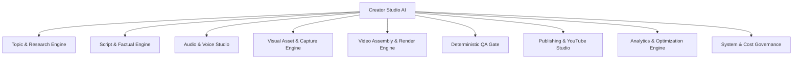

# Product Requirements Document (PRD)
## Creator Studio AI — Autonomous Faceless YouTube Production Platform

**Document Version:** 1.0.0  
**Status:** Approved for Architectural Design  
**Author:** Multidisciplinary Product & Architecture Team  
**Project Owner:** Muhammad Ali ([alibuild.site](https://alibuild.site))  
**Target Delivery Window:** MVP Phase Q1–Q2  

---

### Table of Contents
1. [Product Overview](#1-product-overview)
2. [Problem Statement](#2-problem-statement)
3. [Product Vision](#3-product-vision)
4. [Product Objectives & OKRs](#4-product-objectives--okrs)
5. [Target Audience](#5-target-audience)
6. [User Personas](#6-user-personas)
7. [User Stories](#7-user-stories)
8. [Complete Feature Inventory](#8-complete-feature-inventory)
9. [Functional Requirements](#9-functional-requirements)
10. [Non-Functional Requirements](#10-non-functional-requirements)
11. [AI Automation Requirements](#11-ai-automation-requirements)
12. [Publishing Requirements](#12-publishing-requirements)
13. [Security and Privacy Requirements](#13-security-and-privacy-requirements)
14. [Budget & Resource Constraints](#14-budget--resource-constraints)
15. [Content Quality & Integrity Standards](#15-content-quality--integrity-standards)
16. [YouTube Monetization & Policy Compliance](#16-youtube-monetization--policy-compliance)
17. [Scope Matrix (MVP vs. Future Phases)](#17-scope-matrix-mvp-vs-future-phases)
18. [Product Risks & Mitigation Strategies](#18-product-risks--mitigation-strategies)
19. [Success Metrics & Telemetry](#19-success-metrics--telemetry)
20. [Acceptance Criteria](#20-acceptance-criteria)
21. [Assumptions and Open Decisions](#21-assumptions-and-open-decisions)

---

### 1. Product Overview

**Creator Studio AI** is an enterprise-grade, self-hosted, full-lifecycle autonomous digital video production platform designed to conceptualize, research, script, voice, visualize, assemble, verify, and publish high-quality educational and technology-focused YouTube videos and YouTube Shorts without requiring ongoing manual video editing.

The system acts as a 24/7 autonomous production studio for solo creators, digital operators, and lean media teams. By chaining deterministic software verification, multi-stage AI reasoning (via Google Gemini and open-source models), local media rendering (FFmpeg, local TTS, Playwright automation), and the official YouTube Data API v3, Creator Studio AI converts abstract technology topics into polished, monetizable, policy-compliant video assets on a predictable schedule.

---

### 2. Problem Statement

Creating sustainable, high-frequency YouTube content in technical niches (AI tools, developer productivity, software tutorials) is economically and operationally prohibitive for solo founders and small creators:
1. **Time Sink:** A single high-retention 8-minute technical video requires 12–20 hours across niche research, scripting, factual verification, audio narration, b-roll gathering, timeline editing, caption alignment, thumbnail design, and SEO copywriting.
2. **Context Fragmentation:** Creators switch across 6–9 disparate tools (Notion, ChatGPT/Gemini, ElevenLabs, Premiere Pro/CapCut, Midjourney/Canva, Photoshop, YouTube Studio), producing brittle workflows and human error.
3. **The "AI Slop" Penalty:** Cheap automated faceless channels churn out scraped blog posts with hallucinated facts, robotically cadenced voices, irrelevant stock videos, and black frames. YouTube demonetizes or shadow-bans these channels under policies targeting "reused content", "repetitive content", and "inauthentic automation".
4. **API Cost Explosions:** Cloud-based automated video SaaS tools charge between $60 and $300/month or $5–$15 per rendered video, creating unsustainable overhead before monetization thresholds are met.
5. **Lack of Deterministic Quality Gates:** Fully autonomous systems frequently publish videos with mispronounced terms, hallucinated benchmarks, missing media clips, out-of-sync audio, or distorted visual aspect ratios because there is no automated QA gate before uploading.

---

### 3. Product Vision

Creator Studio AI transforms the YouTube publishing paradigm from manual craftsmanship to an **autonomous, deterministic media assembly line**. 

The system treats every video as an engineered digital product:
- Every claim is grounded against verifiable source URLs and documentation.
- Every scene is procedurally timed against phoneme-accurate audio wave data.
- Every visual asset is dynamically gathered, verified for licensing, or recorded directly from live web demonstrations using headless browser automation.
- Publishing is gated by a rigorous 14-point deterministic Quality Assurance (QA) pipeline.
- The creator transitions from a stressed video editor into an Executive Producer who monitors automated dashboards, approves editorial themes, and inspects quality telemetry.

---

### 4. Product Objectives & OKRs

#### 4.1 Primary Objectives
- **Autonomous Cadence:** Achieve reliable, unattended generation and scheduling of **2 long-form videos (6–10 minutes)** and **3 YouTube Shorts (30–60 seconds)** weekly.
- **Zero-Cost Foundation:** Leverage owner's Google AI Pro subscription resources, Gemini API free tiers, local open-source TTS/FFmpeg engines, and free-tier infrastructure (Supabase, Cloudflare R2, Vercel) to maintain operational costs at <$5/month initially.
- **Strict Quality Enforcement:** Guarantee 0% black-frame incidents, 0% audio clipping, 100% caption synchronization accuracy, and 100% synthetic media disclosure compliance.
- **Monetization Readiness:** Guarantee that 100% of generated content adheres strictly to YouTube Partner Program (YPP) guidelines on original commentary, educational value, and copyright compliance.

#### 4.2 Key Results (6-Month Horizon)
- **KR 1:** Successfully produce and publish 24 consecutive long-form videos and 36 YouTube Shorts over 12 weeks with zero pipeline crashes.
- **KR 2:** Maintain an automated QA rejection/correction rate under 15% without human intervention.
- **KR 3:** Achieve an average YouTube audience retention rate >40% at the 3-minute mark on long-form content.
- **KR 4:** Keep total monthly external API infrastructure costs strictly under $10.00 USD.

---

### 5. Target Audience

#### 5.1 Primary Audience
- **The Solo Technical Builder/Founder:** Technical creators like Muhammad Ali who manage multiple software products and want a professional, authoritative YouTube presence in the AI and developer tooling niche without dedicating 25 hours per week to video production.

#### 5.2 Secondary Audience
- **Digital Media Operators & Agency Owners:** Operators managing multiple faceless niche channels (finance, SaaS tools, technology explainers) who require a hardened, auditable production pipeline with deterministic QA and multi-channel scheduling.

---

### 6. User Personas

#### Persona 1: Muhammad Ali (Executive Producer & Solo Founder)
- **Role:** Founder, Full-Stack Engineer, Channel Owner.
- **Context:** Runs multiple digital products ([alibuild.site](https://alibuild.site)), possesses a Google AI Pro Family subscription, Windows workstation, and limited dedicated GPU rendering hardware.
- **Goals:** Establish an authoritative YouTube channel covering AI productivity tools, coding tutorials, and web tech; build organic distribution; generate traffic for software portfolio.
- **Frustrations:** Dislikes repetitive video timeline slicing, hunting for b-roll, manual subtitle alignment, and paying steep SaaS fees for low-quality AI video generators.
- **Workflow:** Reviews weekly topic proposals on mobile or desktop dashboard; overrides or approves high-level concepts; lets system autonomously script, voice, render, QA, and upload as "Unlisted" or "Scheduled".

#### Persona 2: The Automated Channel Operations Manager (System Agent)
- **Role:** Autonomous Background Pipeline Orchestrator.
- **Context:** Background worker processes executing on worker nodes.
- **Goals:** Maximize pipeline throughput, enforce token and cost limits, gracefully retry transient network failures, and enforce quality gate vetoes prior to any YouTube upload.

---

### 7. User Stories

| ID | User Role | Action / Requirement | Desired Outcome | Acceptance Criteria |
|:---|:---|:---|:---|:---|
| **US-01** | Channel Owner | Connect YouTube Channel via secure OAuth 2.0 | Authorize automated uploads and read channel analytics | OAuth tokens securely stored with AES-256; token refresh is automatic |
| **US-02** | Channel Owner | Define niche keywords, competitor channels, and RSS feeds | Discover high-opportunity video topics automatically | System generates weekly scored topics with search volume & competition estimates |
| **US-03** | Channel Owner | Toggle between "Fully Autonomous" and "Review Required" | Retain manual veto power on scripts or final renders | In Review mode, pipeline halts at `NEEDS_ATTENTION` or `READY_FOR_REVIEW` |
| **US-04** | Channel Owner | Configure monthly and daily AI API spending caps | Prevent unexpected billing charges on Gemini or cloud services | Pipeline pauses immediately upon hitting 95% of spending or quota limits |
| **US-05** | Pipeline Worker | Fact-check all numerical, temporal, and tool claims | Prevent hallucinated facts in generated scripts | Claims extracted, cross-referenced with search evidence, and confidence-scored |
| **US-06** | Pipeline Worker | Record real-time headless browser interactions of target tools | Produce high-retention, authentic b-roll demonstration footage | Playwright executes scripted interactions and captures 1080p 60fps MP4 video |
| **US-07** | Pipeline Worker | Enforce 14 automated QA checks prior to upload | Avoid publishing broken, muted, or copyright-infringing content | Any check failure sets project state to `FAILED_QA` and triggers diagnostic alert |
| **US-08** | Channel Owner | Inspect post-publishing YouTube performance in real time | Feed view velocity, CTR, and retention metrics into future topic scoring | Analytics snapshots periodically collected and correlated with topic tags |

---

### 8. Complete Feature Inventory



#### Module 1: Topic Discovery & Research Engine
- Multi-source ingestion: GitHub Trending, Hacker News, Reddit (r/Artificial, r/WebDev), Product Hunt, arXiv tech summaries, Google Trends RSS.
- Topic Opportunity Scoring: Scoring algorithm evaluating Search Volume, Competition Density, Evergreen Potential, and Alignment with Channel Niche.
- Competitor Video Gap Analysis: Detection of high-performing competitor videos with outdated information.
- Deduplication Engine: Semantic vector search against historical channel videos to prevent redundant coverage.

#### Module 2: Scriptwriting & Claim Verification Studio
- Multi-Stage Script Generation: Hook (0–15s), Retention Problem (15–45s), Educational Core / Step-by-Step Breakdown, Practical Demonstration, Call to Action.
- Dual-Format Scriptwriter: Specialized templates for Long-Form (1200–1800 words) and Shorts (130–180 words).
- Claim Extraction Parser: Automatic extraction of statistical, benchmark, pricing, and temporal statements into structured JSON claims.
- Fact-Checking Agent: Dual-source web search verification with URL citation tracking and confidence scoring (0.00–1.00). Claims scoring <0.80 are automatically rewritten or flagged.

#### Module 3: Audio & Voice Narration Studio
- Multi-Provider TTS Abstraction: Support for Local TTS engines (Edge-TTS, Piper, Kokoro-TTS) and Cloud fallback.
- Pronunciation Dictionary & Lexicon: Custom SSML/phonetic maps for tech terms (e.g., "PostgreSQL", "OAuth", "FastAPI", "scikit-learn").
- Audio Normalization Pipeline: EBU R128 loudness normalization (-14 LUFS target for YouTube), dynamic compression, and high-pass filtering (80 Hz).
- Word-Level Timestamp Alignment: Phoneme/word alignment generation (via Whisper or TTS engine timings) for frame-accurate caption syncing.

#### Module 4: Visual Asset & Demonstration Capture Engine
- Automated Playwright Web Capture: Scripted headless/headful browser sessions recording live websites, code execution, and tool interactions at 1080p 60fps.
- Dynamic Code Syntax Highlighter: High-resolution animated code typing widgets (via Carbon/Prism automation).
- Curated Creative Commons & Pexels/Pixabay Media Search: License-verified b-roll retrieval with SHA-256 asset hash tracking.
- AI Image Generation (Fallback): Local Stable Diffusion or Gemini Imagen integration with strict aesthetic style presets (cyberpunk tech, clean minimalist UI, dark isometric vectors).

#### Module 5: Procedural Video Assembly & Render Pipeline
- FFmpeg Rendering Core: Multi-track composite rendering (Voice, Music, Demonstration Video, Motion Graphics, Subtitles).
- Kinetic Typography Subtitle Generator: Word-by-word karaoke-style animated captions with custom font, stroke, and highlight styling.
- Aspect Ratio Adapters: 16:9 Landscape (1920x1080) for long-form; 9:16 Portrait (1080x1920) for Shorts.
- Background Music Ducker: Procedural audio ducking dropping background music by -18 dB during active voiceover tracks.

#### Module 6: Thumbnail Studio & Metadata Generator
- Thumbnail Composition Engine: Automated 1280x720 graphic generation with 3-element hierarchy (Bold Keyword Text, High-Contrast Tool Logo, Contextual Badge/Glow).
- A/B Variant Generator: Automatic generation of 3 thumbnail variants (Contrasting colors, varied text hooks) for future A/B testing.
- YouTube SEO Optimizer: Title generation (CTR-optimized, avoiding clickbait penalties), chapterized timestamps, descriptive markdown descriptions, and tag arrays.
- Synthetic Content Compliance Tagging: Automated inclusion of YouTube's mandatory "Altered or Synthetic Content" metadata flag.

#### Module 7: Deterministic Quality Assurance Gate (The "Veto Gate")
- Black Frame & Freeze Detector: FFmpeg `blackdetect` and `freezedetect` filters scan rendered MP4 files.
- Audio Silence & Clipping Scanner: Detection of unexpected audio dropouts (>1.5s) or digital clipping (>0.0 dBFS).
- Subtitle Sync Verification: Mathematical validation confirming caption timestamps do not exceed video duration or voice track length.
- Content Uniqueness & Repetition Filter: Levenshtein & cosine similarity check against all prior published channel transcripts to guarantee originality.

#### Module 8: Publishing, Scheduling & YouTube Management
- YouTube Data API v3 Direct Integration: Resumable chunked file upload (up to 256MB chunks).
- Privacy State Management: Direct publish to `private`, `unlisted`, or `public` with scheduled timestamp.
- Custom Playlist Assignment: Automatic routing to playlists (e.g., "AI Tool Reviews", "Python Automation Guides").
- First-Comment Pinned Engagement: Auto-posting of a relevant discussion starter and link to channel resources.

#### Module 9: Channel Analytics & Content Intelligence
- YouTube Analytics API Ingestion: Real-time pull of Impressions, CTR, Average View Duration (AVD), Retention Curves, and Subscriber conversion.
- Feedback Loop Topic Booster: Algorithmic weight adjustment giving higher priority to topic categories that exceed median channel retention by +15%.
- Dead Weight Pruning: Automatic de-prioritization of formats or topics showing steep 30-second drop-offs.

#### Module 10: Governance, Budget & Resource Management
- API Quota Sentinel: Real-time tracking of Gemini API tokens and RPM/TPM limits.
- Daily & Monthly Hard Budget Limits: Immediate system halt if API spend crosses user-configured threshold ($0.00 default for free-tier mode).
- Worker Health & Heartbeat Monitor: Auto-recovery of orphaned rendering tasks after machine restarts or power failures.

---

### 9. Functional Requirements

#### 9.1 Topic Ingestion & Scoring
- **FR-101:** The system shall ingest RSS feeds, GitHub API trending endpoints, and manual topic inputs on a scheduled cron cadence.
- **FR-102:** The system shall compute a Composite Opportunity Score ($S \in [0, 100]$) based on:
  $$S = 0.35 \times \text{SearchInterest} + 0.25 \times \text{NicheRelevance} + 0.20 \times \text{Novelty} + 0.20 \times \text{HistoricalRetentionBonus}$$
- **FR-103:** Topics with $S < 60$ shall be automatically archived without human notification.

#### 9.2 Scripting & Fact-Checking
- **FR-201:** The system shall parse generated scripts into discrete scene objects containing: `scene_index`, `narration_text`, `duration_estimated`, `visual_intent`, `on_screen_code`, and `claim_references`.
- **FR-202:** Every statement referencing a metric, release date, pricing model, or software benchmark shall generate a `ScriptClaim` record.
- **FR-203:** The Fact Verification Service shall query search APIs, retrieve top 3 search result snippets, and evaluate verification confidence.
- **FR-204:** If any claim scores below 0.80 confidence, the script generation service shall execute a targeted rewrite prompt to replace the claim with verified information or remove it.

#### 9.3 Media Synthesis & Web Recording
- **FR-301:** The Media Capture Service shall launch a sandboxed Playwright Chromium instance with custom viewport (1920x1080 or 1080x1920).
- **FR-302:** The system shall execute user-safe automation scripts (scrolling, clicking interactive elements, highlighting code) and record video streams as lossless H.264 MP4.
- **FR-303:** Audio narration files shall be rendered per scene and joined with precise sample accuracy.

#### 9.4 Assembly, Rendering & Subtitles
- **FR-401:** FFmpeg shall combine scene media, narration, background music, visual overlays, and ASS/SRT subtitles into a standard H.264 / AAC MP4 file with `yuv420p` pixel format.
- **FR-402:** Render jobs must report percentage progress at least once every 5 seconds to the database for UI display.
- **FR-403:** The rendering service must support graceful cancellation and temporary file cleanup on disk.

#### 9.5 Quality Assurance Veto Rules
- **FR-501:** The QA Service shall reject any video where total black frame duration exceeds 0.25 seconds.
- **FR-502:** The QA Service shall reject any video where audio loudness deviates from $-14.0 \text{ LUFS} \pm 1.5 \text{ LUFS}$ or max true peak exceeds $-1.0 \text{ dBTP}$.
- **FR-503:** The QA Service shall reject any video where visual asset license validation is missing or non-compliant.

---

### 10. Non-Functional Requirements

#### 10.1 Performance & Throughput
- **NFR-101 (Render Time):** On standard developer hardware (4-core modern CPU, no dedicated GPU), long-form 8-minute video assembly shall complete in $\le 1.5 \times$ real-time (under 12 minutes).
- **NFR-102 (UI Responsiveness):** All dashboard queries and state transitions shall respond with $P_{95} < 250\text{ ms}$.
- **NFR-103 (Worker Fault Tolerance):** Worker crashes shall not corrupt video assets; jobs shall resume from the last completed state machine checkpoint.

#### 10.2 Reliability & Availability
- **NFR-201 (Self-Hosted Uptime):** The background service must operate continuously without memory leaks ($< 500\text{ MB}$ RSS baseline for backend services).
- **NFR-202 (Idempotency):** Every pipeline task (TTS generation, capture, render, upload) must be idempotent, keyed by `project_id + stage + revision_hash`.

#### 10.3 Maintainability & Code Standards
- **NFR-301 (Modular Decoupling):** AI model providers (Gemini, OpenAI, Anthropic, Ollama) and media engines (FFmpeg, Remotion) must exist behind strict abstract interfaces.
- **NFR-302 (Type Safety):** 100% TypeScript strict mode on frontend; 100% Pydantic/mypy typing on backend.

---

### 11. AI Automation Requirements

1. **Provider Agnosticism:** Core application logic must never directly call proprietary SDK functions without going through `AIProviderInterface`.
2. **Quota & Rate-Limit Safeguards:**
   - Free-tier Gemini 1.5 Flash / Pro limits (15 RPM, 1 million TPM, 1,500 RPD) must be tracked in an in-memory or database token bucket.
   - If 80% of daily quota is exhausted, non-essential background tasks (like bulk topic scoring) must defer to the next 24-hour cycle.
3. **Structured Output Enforcement:** All AI generation prompts must utilize JSON Schema validation (`response_format={"type": "json_object"}`) to guarantee parseable scene plans and claim arrays.
4. **Prompt Versioning:** All system prompts must be stored in the database with incremental semantic versioning (`v1.2.0`), enabling seamless prompt regression testing.

---

### 12. Publishing Requirements

1. **YouTube API Quota Management:**
   - YouTube Data API v3 allocates 10,000 quota units per day by default.
   - A video upload costs 1,600 units.
   - The publishing engine must restrict uploads to a maximum of 4 videos per calendar day to avoid API exhaustion.
2. **Deterministic Pre-Upload Checklist:**
   - Title length $\le 95$ characters.
   - Description contains structured timestamps, links, and disclosure hashtags.
   - Thumbnail file size $\le 2.0\text{ MB}$, resolution $1280 \times 720$, format JPEG/PNG.
   - Privacy set to `unlisted` by default on new channel connections until user enables direct `public` publishing.
3. **Scheduled Publishing:**
   - Publication timestamps must align with channel-specific audience peak hours (e.g., Tuesday & Thursday 14:00 UTC).

---

### 13. Security and Privacy Requirements

1. **Zero Secret Leakage:**
   - YouTube OAuth client secrets, refresh tokens, and AI API keys must never be returned in client-facing API responses.
   - Database storage of refresh tokens must be encrypted using AES-256-GCM with environment-managed encryption keys.
2. **Secure Sandboxing:**
   - Playwright browser captures must execute in an isolated container or restricted sandboxed process with network egress restricted to whitelist domains where appropriate.
   - Execution of arbitrary user-provided scripts is strictly forbidden; browser navigation is driven by parameterized declarative action templates.
3. **Local Data Sovereignty:**
   - Video project drafts, raw audio clips, and screen captures are stored on the owner's controlled disk or private Cloudflare R2 bucket with signed URLs expiring in 15 minutes.

---

### 14. Budget & Resource Constraints

- **Primary Goal:** $0.00 / month incremental software cost during MVP.
- **AI Models:** Gemini API free tier (within 15 RPM / 1,500 RPD) as primary; local open-source models (via Ollama or local ONNX runtime) for claim extraction and parsing.
- **Text-to-Speech:** High-quality local neural TTS (Edge-TTS / Piper / Kokoro) running on local CPU, requiring $0.00$ API budget.
- **Compute:** Local development workstation (Windows 11) for rendering; optional lightweight Linux VPS or free-tier container for background orchestration.
- **Hard Spend Limit:** Global spending cap defaults to **$0.00/month**. If a paid API is connected, the user must explicitly set an absolute dollar ceiling (e.g., $15.00/month). Any transaction that would exceed this ceiling triggers an emergency pipeline halt.

---

### 15. Content Quality & Integrity Standards

To differentiate from generic "AI spam" channels, Creator Studio AI enforces the **Four Pillars of High-Value Content**:
1. **Original Synthesis:** The system must synthesize facts from at least 3 distinct sources (e.g., official docs, GitHub release notes, real benchmark tests) rather than paraphrasing a single blog post.
2. **Visual Authenticity:** At least 60% of video runtime must feature authentic UI interactions, code typing, live terminal execution, or relevant technical diagrams—never generic looping stock footage of business people shaking hands.
3. **Audio Naturalness:** Pauses between sentences must vary naturally (between 250ms and 650ms), and key technical terms must be pronounced accurately using custom phoneme overrides.
4. **Honest Framing:** Clickbait titles with inaccurate promises are blocked. Titles must accurately reflect the contents of the script.

---

### 16. YouTube Monetization & Policy Compliance

The platform is designed to guarantee compliance with the **YouTube Partner Program (YPP)** rules:
- **Avoiding Reused Content:** YouTube demonetizes channels that post content that does not provide significant original commentary or educational value. Every video script must include an analytical viewpoint, comparisons, and unique value-add takeaways.
- **Avoiding Repetitive Content:** Templates must randomize visual layout patterns, transition animations, and background music tracks across videos to ensure no two uploads share identical visual timing.
- **Synthetic Content Disclosure:** In accordance with YouTube's 2024–2025 AI disclosure policies, the platform automatically flags the `hasCustomThumbnail` and sets the `syntheticMedia` flag via the YouTube API to guarantee 100% compliance.
- **Copyright & Fair Use:** Media ingestion strictly uses public domain, CC0, licensed stock APIs, or original user-recorded screen demonstrations.

---

### 17. Scope Matrix (MVP vs. Future Phases)

| Feature Area | Phase 1: MVP (Zero-Cost Focus) | Phase 2: Growth & Scaling | Phase 3: Enterprise / Multi-Channel |
|:---|:---|:---|:---|
| **Channels** | 1 Single Connected Channel | Up to 3 Channels | Unlimited Channels / Agency Multi-Tenancy |
| **Niches** | AI Tools, Tutorials, Coding | Any Tech / Business Niche | Custom Niche Taxonomy & Auto-Tuning |
| **AI LLM** | Gemini Free Tier via Google AI Studio | Gemini 1.5 Pro + Claude 3.5 Sonnet | Dynamic Multi-Model Cost Router |
| **TTS Engine** | Local Edge-TTS / Kokoro / Piper (Free) | ElevenLabs Cloud API (Optional) | Custom Voice Cloning & Multi-Speaker |
| **B-Roll Capture** | Automated Playwright Web Capture + Pexels | + Automated Screen Studio & Terminal | Custom 3D Motion Graphics (Blender CLI) |
| **Video Formats** | Long-Form (16:9) + Shorts (9:16) | Interactive Chapters + Auto-Endscreens | Multi-Language Dubbing & Subtitles |
| **QA Gate** | 14 Deterministic Checks (Local FFmpeg) | Automated AI Visual Frame Inspector | Human-in-the-loop Mobile Review App |
| **Queue & DB** | PostgreSQL (Supabase) + Local Worker | Redis BullMQ + Distributed Workers | Kubernetes Autoscaled Cloud Render Farm |

---

### 18. Product Risks & Mitigation Strategies

| Risk Description | Severity | Likelihood | Mitigation Strategy |
|:---|:---|:---|:---|
| **Gemini Free Tier Quota Exhaustion** | High | Medium | Implement local token-bucket tracking; queue non-critical tasks; fallback to local models via Ollama. |
| **YouTube Shadow-Banning (AI Content)** | Critical | Low | Enforce original web demonstrations, accurate fact-checking, randomized visual structures, and mandatory synthetic tags. |
| **Playwright Web Scraping Fragility** | Medium | High | Maintain fallback static slide / code highlighter generation if target website blocks headless browser or changes DOM. |
| **Local Render CPU Overload** | Medium | Medium | Throttle concurrent FFmpeg render jobs to 1; execute renders during configured idle off-peak hours (e.g., 02:00–06:00). |
| **YouTube API Token Revocation** | High | Low | Automated proactive token refresh 30 minutes before expiration; persistent health checks on credential status. |

---

### 19. Success Metrics & Telemetry

```
[System Health Metrics]
├── Job Pipeline Failure Rate: < 2.0%
├── Render Time to Video Length Ratio: < 1.5x
├── QA Automatic Rejection Rate: < 15%
└── Average Daily API Spend: $0.00 (within free allowances)

[Content Performance Metrics]
├── 30-Second Audience Retention: > 65%
├── 3-Minute Audience Retention: > 40%
├── Click-Through Rate (CTR): > 5.5%
└── Upload-to-Publish SLA: 100% adherence to schedule
```

---

### 20. Acceptance Criteria

1. **System Initialization:** A user can clone the repository, run the setup script, configure a Gemini API key and YouTube OAuth credentials, and see a healthy system dashboard.
2. **Automated End-to-End Cycle:** The system can run from a seed keyword ("Top 3 Open Source AI Agents") to a fully rendered 1080p video with subtitles, thumbnail, and scheduled YouTube upload without manual human editing.
3. **Quality Veto Demonstration:** Intentionally corrupting a media asset or introducing silence triggers an immediate QA fail state and prevents publishing.
4. **Cost Transparency:** The dashboard displays exact token usage, API calls made, and total dollar expenditure ($0.00 verified).

---

### 21. Assumptions and Open Decisions

#### Assumptions
- Google AI Studio provides sufficient free-tier Gemini 1.5 Flash/Pro tokens to script and plan 2 long-form videos and 3 Shorts per week without mandatory paid billing.
- Playwright can execute on the owner's Windows development environment without sandboxing permission blocks.
- The YouTube Data API application is approved or operating in testing mode with the owner's authenticated Google Account.

#### Open Architectural Decisions
- **Decision 1:** *Audio Engine Selection:* Default to `Edge-TTS` for instant zero-dependency free neural voices, with optional local `Kokoro-82M` for higher emotional expressiveness if local CPU permits. (Recommendation: Provide configurable runtime switch).
- **Decision 2:** *Queue Backing Store:* PostgreSQL-backed queue (via `FOR UPDATE SKIP LOCKED`) vs. Redis. (Recommendation: PostgreSQL queue for MVP to eliminate Redis infrastructure dependency).
