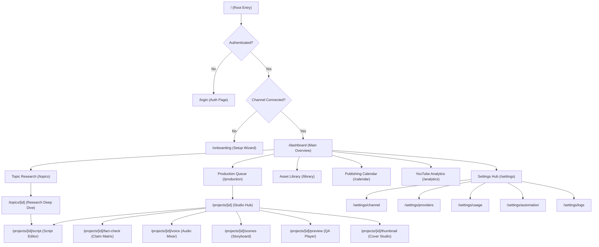
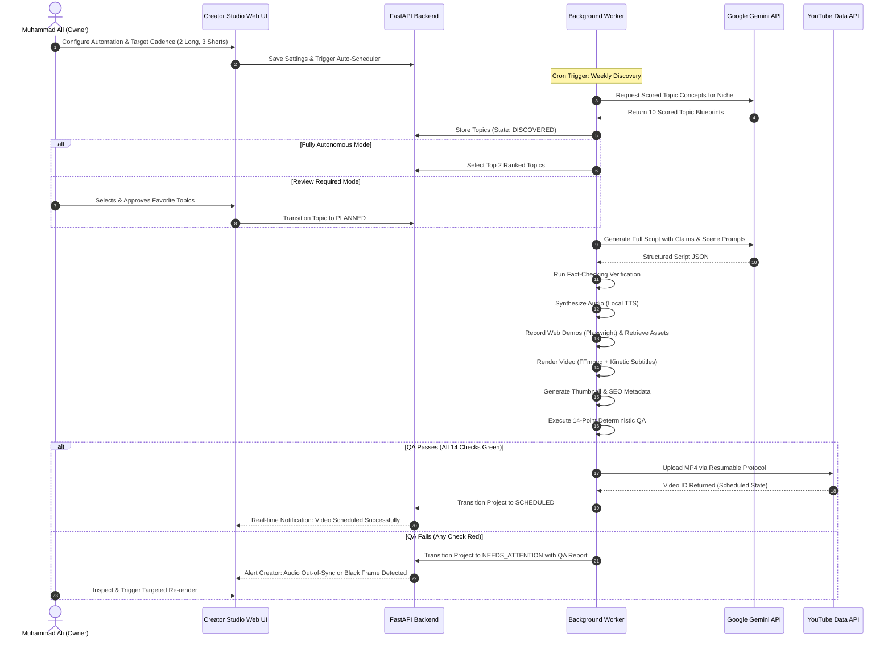
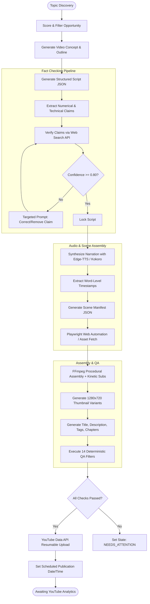
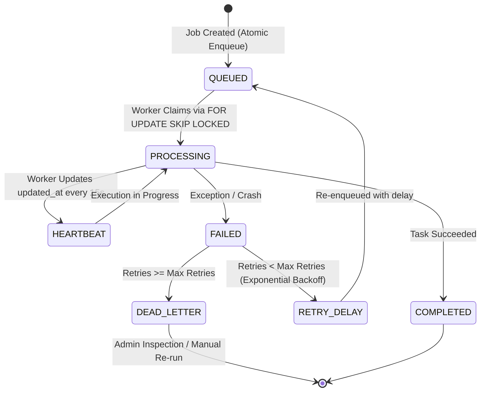
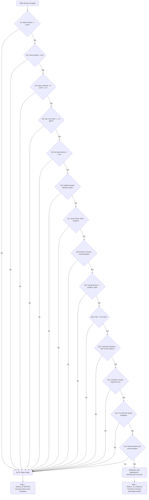
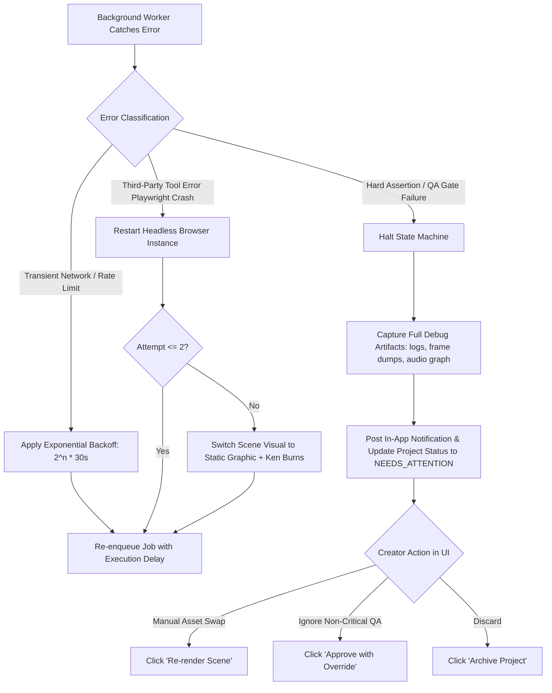

# Application Architecture & User Journey (App Flow)
## Creator Studio AI — End-to-End Workflow & Navigation Blueprint

**Document Version:** 1.0.0  
**Status:** Approved for UI/UX & Frontend Implementation  
**Project Owner:** Muhammad Ali ([alibuild.site](https://alibuild.site))  

---

### Table of Contents
1. [Global Application Architecture](#1-global-application-architecture)
2. [Master Mermaid Flowcharts](#2-master-mermaid-flowcharts)
   - 2.1 [Application Navigation Hierarchy](#21-application-navigation-hierarchy)
   - 2.2 [End-to-End User Journey](#22-end-to-end-user-journey)
   - 2.3 [Complete Video Production Workflow](#23-complete-video-production-workflow)
   - 2.4 [Background Job Lifecycle](#24-background-job-lifecycle)
   - 2.5 [Automatic Publishing Decision Flow (Quality Gate)](#25-automatic-publishing-decision-flow-quality-gate)
   - 2.6 [Failure and Recovery Workflow](#26-failure-and-recovery-workflow)
3. [Granular Step-by-Step Journeys](#3-granular-step-by-step-journeys)
   - 3.1 Authentication & Channel Connection
   - 3.2 Provider & Cost Configuration
   - 3.3 Topic Discovery, Research & Selection
   - 3.4 Scriptwriting & Factual Claim Verification
   - 3.5 Voice Narration & Audio Mastering
   - 3.6 Scene Planning & Visual Asset Synthesis
   - 3.7 Video Rendering & Subtitle Generation
   - 3.8 Thumbnail Generation & Metadata SEO
   - 3.9 Quality Assurance & Publishing
   - 3.10 Post-Publishing Analytics & Continuous Learning
4. [Comprehensive Page-by-Page Specifications](#4-comprehensive-page-by-page-specifications)
5. [State Machine & Transition Rules](#5-state-machine--transition-rules)

---

### 1. Global Application Architecture

Creator Studio AI operates on a **hybrid synchronous/asynchronous model**:
- **Synchronous Interaction Layer:** Next.js (App Router) user interface communicating via REST / Server Actions to the FastAPI backend. Creators monitor production status, inspect script drafts, preview rendered media, and configure automation rules.
- **Asynchronous Execution Layer:** Python background workers running persistent state-machine jobs. Tasks like video scraping, TTS synthesis, FFmpeg rendering, and YouTube uploads execute without blocking the UI.
- **Persistence & Synchronization:** PostgreSQL (Supabase) manages state, relational metadata, and durable queue operations. Real-time updates push via WebSocket/Server-Sent Events (SSE) or reactive polling.

---

### 2. Master Mermaid Flowcharts

#### 2.1 Application Navigation Hierarchy


#### 2.2 End-to-End User Journey


#### 2.3 Complete Video Production Workflow


#### 2.4 Background Job Lifecycle


#### 2.5 Automatic Publishing Decision Flow (Quality Gate)


#### 2.6 Failure and Recovery Workflow


---

### 3. Granular Step-by-Step Journeys

#### 3.1 Authentication & Channel Connection
1. **Landing:** Creator navigates to `/login`.
2. **Supabase Auth:** Authenticates via secure email magic link or GitHub OAuth.
3. **Onboarding Guard:** System verifies whether an active YouTube channel record exists. If not, redirects to `/onboarding`.
4. **YouTube OAuth 2.0:** Creator clicks "Connect YouTube Channel".
5. **Consent Screen:** Google consent screen requests scopes:
   - `https://www.googleapis.com/auth/youtube.upload`
   - `https://www.googleapis.com/auth/youtube.readonly`
   - `https://www.googleapis.com/auth/yt-analytics.readonly`
6. **Token Exchange:** Backend receives authorization code, exchanges for access and refresh tokens, encrypts refresh token with AES-256-GCM, and stores in `channels` table.
7. **Confirmation:** System queries channel branding details (Title, Avatar, Subscriber Count) and lands on `/dashboard`.

#### 3.2 Provider & Cost Configuration
1. **Access:** Creator visits `/settings/providers`.
2. **Gemini Configuration:**
   - Enters Google AI Studio API Key.
   - Selects default models: `gemini-1.5-flash` (fast, free tier) and `gemini-1.5-pro` (complex script structuring).
   - Sets Free Tier Safeguard toggle (`ON` by default, limits to 15 RPM / 1,500 RPD).
3. **Budget Caps:**
   - Enters Monthly Spend Ceiling ($0.00 default).
   - Configures Daily Hard Limit ($0.00 default).
   - Toggles: "Pause pipeline on budget exhaustion".
4. **TTS Engine Selection:**
   - Chooses `Edge-TTS` (Zero cost, high-quality neural voices like `en-US-ChristopherNeural` or `en-US-GuyNeural`).
   - Configures speaking rate (+5%), pitch (+0Hz), and pronunciation overrides.

#### 3.3 Topic Discovery, Research & Selection
1. **Cadence Engine:** Background cron triggers every Monday at 00:00 UTC or on-demand via the "Discover Topics" button.
2. **Source Ingestion:** Workers pull RSS feeds (Hacker News, r/Artificial, GitHub Trending, Product Hunt).
3. **Synthesis & Scoring:** Gemini processes raw feeds against the channel's target audience profile.
4. **Scoring Algorithm:** Computes Search Volume, Niche Relevance, Novelty, and Estimated Watch Retention.
5. **Presentation:** Displays in `/topics` sorted by Opportunity Score.
6. **Selection:** Creator clicks "Promote to Video Project" (or automation engine auto-promotes top 2).

#### 3.4 Scriptwriting & Factual Claim Verification
1. **Generation:** Script engine generates structured 5-part script (Hook, Problem, Deep Dive, Code/Demo, Conclusion).
2. **Claim Extraction:** Dedicated parser extracts claims:
   - *Example:* "Python 3.13 was released on October 7, 2024 with free-threaded mode."
   - Extracted as: `{ entity: "Python 3.13", claim_type: "date_and_feature", target: "October 7, 2024" }`.
3. **Fact Checking:** Worker executes web search via search provider abstraction.
4. **Evaluation:** Claims with verified citations receive confidence score $\ge 0.90$.
5. **Audit UI:** Displays in `/projects/[id]/fact-check` with green checkmarks or highlighted issues.

#### 3.5 Voice Narration & Audio Mastering
1. **SSML Parsing:** Script narration is processed into SSML with configured pauses and tech pronunciations.
2. **Audio Synthesis:** Local neural TTS generates WAV audio files per scene.
3. **Timestamp Extraction:** Generates word-level timestamp array `[{ word: "Python", start: 0.12, end: 0.45 }, ...]`.
4. **Post-Processing:**
   - High-pass filter at 80 Hz to eliminate low-end rumble.
   - Dynamic 2-band compression for vocal presence.
   - EBU R128 loudness normalization to exact $-14.0\text{ LUFS}$.

#### 3.6 Scene Planning & Visual Asset Synthesis
1. **Storyboard Generation:** System maps each voiceover sentence to a visual layout archetype:
   - `BROWSER_CAPTURE`: Live headless web interaction.
   - `CODE_TERMINAL`: Animated code typing with syntax highlighting.
   - `INFOGRAPHIC_CARD`: Isometric 2D card with key metric.
   - `BROLL_OVERLAY`: Curated high-res tech clip.
2. **Demonstration Recording:** Playwright runs automation script on target tool URL, typing code or clicking UI, recording directly to 1080p MP4.

#### 3.7 Video Rendering & Subtitle Generation
1. **Kinetic Caption Generator:** Converts word-level timestamps into styled ASS subtitles with active-word highlight color (`#FF7A00`).
2. **FFmpeg Multi-Track Assembly:**
   - Track 0: Video stream (concatenated scene demonstrations with crossfades).
   - Track 1: Mastered voice narration.
   - Track 2: Background music (looped ambient lofi/tech, ducked by -18 dB during speech).
   - Overlay: Burned-in ASS kinetic subtitles.
3. **Encoding:** H.264 video (`yuv420p`, CRF 20, Preset Medium), AAC audio (192 kbps, 48 kHz).

#### 3.8 Thumbnail Generation & Metadata SEO
1. **Pillow Graphics Engine:** Assembles 1280x720 thumbnail with high-contrast 3-layer stack:
   - Dark textured background with orange radial gradient accent.
   - Centered tool logo / high-impact icon.
   - 3-word bold title hook (e.g., "STOP WRITING SQL").
2. **Variant Generation:** Generates 3 color/layout variants for thumbnail testing.
3. **SEO Package:**
   - Title: Optimized under 80 characters with high search intent.
   - Description: 3-paragraph summary, clickable chapter timestamps, social links, and synthetic media disclosure.
   - Tags: 15 targeted comma-separated tags.

#### 3.9 Quality Assurance & Publishing
1. **Automated QA Suite:** Executes 14 deterministic checks.
2. **Upload Execution:** If 100% passed, YouTube Resumable Upload transfers MP4 file in 32MB chunks.
3. **Metadata Application:** Assigns title, description, thumbnail, tags, and category (28: Science & Technology).
4. **State Transition:** Set privacy to `private` or `unlisted` (or `scheduled` if date provided).

#### 3.10 Post-Publishing Analytics & Continuous Learning
1. **Telemetry Polling:** Scheduled job runs at +24h, +48h, +7d post-upload.
2. **Metrics Gathered:** Views, CTR, Average View Duration (AVD), Audience Retention curve at 30 seconds.
3. **Feedback Optimization:** High-performing topic tags automatically increase topic generation weighting in subsequent weekly research cycles.

---

### 4. Comprehensive Page-by-Page Specifications

| Route | Page Name | Primary Actions | Key Data Displayed | Navigation Outlets |
|:---|:---|:---|:---|:---|
| `/login` | Auth Portal | Sign In, Sign Up, Magic Link | Form inputs, status messages | `/dashboard` on success |
| `/onboarding` | Setup Wizard | Connect YouTube, Enter Gemini Key, Set Limits | Step progress, connection status | `/dashboard` on finish |
| `/dashboard` | Executive Dashboard | Trigger Quick Video, View Active Jobs, Inspect Feed | Active pipeline cards, upcoming schedule, weekly quota | All secondary routes |
| `/topics` | Topic Research | Discover Topics, Filter by Score, Add Manual | Opportunity score list, competition, volume tags | `/topics/[id]`, `/projects/create` |
| `/topics/[id]` | Topic Deep Dive | Promote to Project, Dismiss, Edit Outline | Source URLs, competitor videos, synthesized outline | `/projects/[id]/script` |
| `/production` | Production Queue | Pause Queue, Retry Failed, Filter by Status | Kanban/List of all projects by state machine phase | `/projects/[id]` |
| `/projects/[id]` | Project Studio Hub | Trigger Next Stage, Preview Assets, Cancel Job | Stage stepper, asset preview pane, timeline summary | Script, Fact, Voice, Scene, Preview |
| `/projects/[id]/script` | Script Studio | Edit Hook/Body/CTA, Re-run AI Polish, Lock Script | Scene-by-scene script cards, word count, reading time | `/projects/[id]/fact-check` |
| `/projects/[id]/fact-check`| Fact Verification | Override Claim, Re-verify Claim, Edit Citation | Claim list, source URLs, confidence badges (0-100%) | `/projects/[id]/voice` |
| `/projects/[id]/voice` | Voice Studio | Preview Audio, Adjust Speed/Pitch, Add Pronunciation | Audio waveforms per scene, speaker selector, player | `/projects/[id]/scenes` |
| `/projects/[id]/scenes` | Scene Editor | Swap Asset, Re-record Web Demo, Adjust Duration | Storyboard grid, layout archetypes, asset thumbnails | `/projects/[id]/preview` |
| `/projects/[id]/preview`| Video Preview & QA | Play Full Video, Inspect QA Report, Force Publish | HTML5 video player, 14 QA test results, metadata card| `/calendar`, `/production` |
| `/projects/[id]/thumbnail`| Thumbnail Studio | Select Active Variant, Regenerate, Upload Custom | 3 generated variants, canvas preview, text controls | `/projects/[id]/preview` |
| `/library` | Media Asset Library | Upload B-Roll, Preview Recordings, View Licenses | Filterable grid of images, audio, captures, clips | Asset inspector modal |
| `/calendar` | Publishing Calendar | Reschedule Video, Change Privacy, Sync YouTube | Month/Week grid of scheduled, published, and drafted | `/projects/[id]` |
| `/analytics` | Channel Analytics | Refresh Stats, Filter Date Range, View Retention | View graphs, CTR charts, top topic leaderboard | External YouTube Studio |
| `/settings/channel` | Channel Settings | Reconnect OAuth, Set Upload Defaults, Playlists | Channel title, avatar, quota status, default privacy | Settings sub-nav |
| `/settings/providers`| Provider Settings | Save API Keys, Test Connection, Set Models | Gemini, Search, TTS status, test latency | Settings sub-nav |
| `/settings/usage` | Usage & Budget | Set Monthly Cap, Reset Quota, View Token History | Dollar spend vs cap, daily token chart, cost/video | Settings sub-nav |
| `/settings/automation`| Automation Engine | Set Cadence (Long/Short), Auto-Publish Toggle | Weekly schedule picker, autonomous threshold sliders | Settings sub-nav |
| `/settings/logs` | System Health & Logs | Filter Logs, Trigger Worker Heartbeat, Export DB | Worker status, real-time log stream, error traces | Settings sub-nav |

---

### 5. State Machine & Transition Rules

```
[IDEA]
  │ (User or Auto selects topic)
  ▼
[RESEARCHING]
  │ (Web sources gathered & analyzed)
  ▼
[PLANNED]
  │ (Outline confirmed)
  ▼
[SCRIPTING]
  │ (Structured script generated)
  ▼
[FACT_CHECKING]
  │ (Claims extracted & verified >= 0.80)
  ▼
[VOICE_GENERATING]
  │ (TTS generated & aligned)
  ▼
[VISUALS_GENERATING]
  │ (Playwright captures & media retrieved)
  ▼
[RENDERING]
  │ (FFmpeg assembly & subtitles burned)
  ▼
[QUALITY_CHECK]
  │
  ├── [Fails any of 14 checks] ────────► [NEEDS_ATTENTION] ──► (Manual fix & Re-run)
  │                                                                 │
  └── [Passes all 14 checks]                                        ▼
        │                                                     [QUALITY_CHECK]
        ▼
[READY_TO_PUBLISH]
  │ (Publishing worker triggered)
  ▼
[UPLOADING]
  │ (YouTube API resumable upload)
  ▼
[SCHEDULED] ────────► [PUBLISHED] ────────► [ARCHIVED]
```

#### Transition Enforcement Rules
1. **No Skipped Steps:** A project cannot transition from `SCRIPTING` to `RENDERING` without passing `FACT_CHECKING` and `VOICE_GENERATING`.
2. **QA Veto Authority:** Only a 100% green score on the 14 deterministic tests allows transition to `READY_TO_PUBLISH`. No human or AI override can bypass a fatal error (e.g., zero-byte file or severe audio clipping) without re-rendering.
3. **Atomic State Locking:** When a worker picks up a project in state `X`, it updates the state to `X_PROCESSING` to prevent duplicate concurrent processing by another worker thread.
