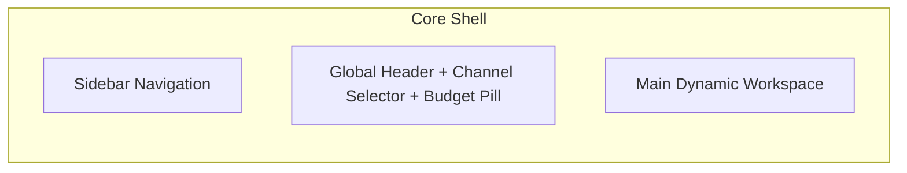

# UI/UX Design System & Screen Specifications
## Creator Studio AI — Premium Dark-First Creative Suite

**Document Version:** 1.0.0  
**Status:** Approved for Frontend Implementation  
**Design Direction:** High-Precision Dark Creative Studio (Linear / Vercel Aesthetic with Orange Kinetic Energy)  
**Project Owner:** Muhammad Ali ([alibuild.site](https://alibuild.site))  

---

### Table of Contents
1. [Brand Identity & Aesthetic Philosophy](#1-brand-identity--aesthetic-philosophy)
2. [Global Design System Specifications](#2-global-design-system-specifications)
   - 2.1 Color Palette & HEX Codes
   - 2.2 Typography Hierarchy
   - 2.3 Spacing & Grid System
   - 2.4 Elevation, Shadows & Glassmorphism
   - 2.5 Border Radii & Border Accents
   - 2.6 Iconography System (Lucide)
   - 2.7 Component Specifications (Buttons, Inputs, Cards, Tables, Dialogs, Dropdowns, Notifications, Progress Bars)
   - 2.8 System States (Loading Skeletons, Empty States, Error Boundaries)
   - 2.9 Responsive Breakpoints
   - 2.10 Accessibility Standards (WCAG 2.1 AA)
3. [Comprehensive 21-Screen Specifications](#3-comprehensive-21-screen-specifications)
   - 01. Login & Registration (`/login`)
   - 02. Onboarding Setup Wizard (`/onboarding`)
   - 03. Main Executive Dashboard (`/dashboard`)
   - 04. Topic Research Hub (`/topics`)
   - 05. Topic Deep Dive & Concept Studio (`/topics/[id]`)
   - 06. Script Studio & Teleprompter (`/projects/[id]/script`)
   - 07. Fact-Checking & Claim Matrix (`/projects/[id]/fact-check`)
   - 08. Voice Studio & Audio Mixer (`/projects/[id]/voice`)
   - 09. Video Studio Master Hub (`/projects/[id]`)
   - 10. Scene Storyboard Editor (`/projects/[id]/scenes`)
   - 11. Media Asset Library (`/library`)
   - 12. Thumbnail Studio & Graphic Canvas (`/projects/[id]/thumbnail`)
   - 13. Production Queue & Pipeline Kanban (`/production`)
   - 14. Video Player & Deterministic QA Inspector (`/projects/[id]/preview`)
   - 15. Publishing Calendar & Schedule Planner (`/calendar`)
   - 16. YouTube Analytics & Audience Retention (`/analytics`)
   - 17. Channel Profile & Upload Defaults (`/settings/channel`)
   - 18. AI Provider & Model Management (`/settings/providers`)
   - 19. Usage, Tokens & Cost Governance (`/settings/usage`)
   - 20. Automation Scheduler & Cadence Engine (`/settings/automation`)
   - 21. System Health, Worker Diagnostics & Logs (`/settings/logs`)

---

### 1. Brand Identity & Aesthetic Philosophy

Creator Studio AI embodies the feel of an **autonomous mission control room for high-retention digital media creation**:
- **Tone:** Engineered, precise, quiet, authoritative, and frictionless.
- **Visual Contrast:** Near-black background depths paired with crisp white typography and a vibrant signature **Vivid Ember Orange (`#FF6B00` / `#FF7A00`)** accent representing creative energy, rendering activity, and broadcast readiness.
- **Restraint:** No noisy neon clutter or gratuitous animations. Glows and glass reflections are subtle, utilized strictly to indicate active state execution (e.g., audio waveform pulses or rendering progress).

---

### 2. Global Design System Specifications

#### 2.1 Color Palette & HEX Codes

```
[Background Layers]
├── Surface 0 (Canvas Base):    #090A0D (Deepest obsidian)
├── Surface 1 (Cards / Panels): #111318 (Elevated container)
├── Surface 2 (Sub-cards/Hover):#181B22 (Interactive elements)
└── Surface 3 (Borders / Lines):#222631 (Subtle geometric divider)

[Accent Palette - Vivid Ember]
├── Primary Accent:             #FF7A00 (Signature energetic orange)
├── Accent Hover:               #FF8F26 (Lighter interactive hover)
├── Accent Pressed:             #E05D00 (Deep saturated active)
├── Accent Surface (Muted):     rgba(255, 122, 0, 0.10) (Pill badge fills)
└── Accent Glow:                rgba(255, 122, 0, 0.25) (Active rendering glow)

[Text & Foreground]
├── Text Primary:               #F5F6F8 (98% contrast white)
├── Text Secondary:             #9DA4B3 (Neutral muted gray)
├── Text Tertiary / Muted:      #5E6573 (Subtle timestamps & meta)
└── Text Inverted:              #090A0D (Text on vibrant accents)

[Semantic Status Colors]
├── Success / Passed QA:        #10B981 (Emerald Green)
├── Warning / Attention:        #F59E0B (Amber)
├── Error / Failed Veto:        #EF4444 (Crimson Red)
└── Informational / Queued:     #3B82F6 (Electric Blue)
```

#### 2.2 Typography Hierarchy
- **Primary Font Family:** Inter or Geist Sans (`font-sans`) for UI, labels, and analytical data.
- **Monospace Font Family:** JetBrains Mono (`font-mono`) for code snippets, timestamps (`04:32.18`), token counts, and terminal logs.
- **Type Scale:**
  - `Display 1`: 36px / 44px line-height, Bold (`font-bold tracking-tight`)
  - `Heading 1`: 28px / 36px, Semi-Bold (`font-semibold`)
  - `Heading 2`: 20px / 28px, Semi-Bold
  - `Heading 3`: 16px / 24px, Medium (`font-medium`)
  - `Body Regular`: 14px / 20px, Regular (`text-sm font-normal`)
  - `Body Medium`: 14px / 20px, Medium (`text-sm font-medium`)
  - `Caption / Meta`: 12px / 16px, Regular (`text-xs text-muted-foreground`)
  - `Micro Label`: 10px / 12px, Bold, Uppercase (`text-[10px] font-bold tracking-wider`)

#### 2.3 Spacing & Grid System
- Standard 4px baseline grid (`p-1` = 4px, `p-2` = 8px, `p-3` = 12px, `p-4` = 16px, `p-6` = 24px, `p-8` = 32px, `p-12` = 48px).
- Maximum content width: `1440px` with fluid responsive padding (`px-4 sm:px-6 lg:px-8`).

#### 2.4 Elevation, Shadows & Glassmorphism
- **Subtle Glass Panel:** `bg-[#111318]/80 backdrop-blur-md border border-[#222631]`
- **Card Shadow:** `0 4px 20px -2px rgba(0, 0, 0, 0.5)`
- **Orange Energy Glow (Active State):** `0 0 24px -4px rgba(255, 122, 0, 0.35)`

#### 2.5 Border Radii & Border Accents
- Default Container: `rounded-xl` (12px)
- Interactive Elements (Buttons, Inputs): `rounded-lg` (8px)
- Badges & Pills: `rounded-full` (9999px)
- Border Stroke: 1px solid `#222631` (Hover: `border-[#373D4D]` or `border-[#FF7A00]/50`)

#### 2.6 Iconography System
- **Lucide Icons** exclusively for all iconography (stroke width: 1.75px for elegance, 2.0px for micro icons).

#### 2.7 Component Specifications
- **Button Variants:**
  - `Primary`: `bg-[#FF7A00] text-black font-semibold hover:bg-[#FF8F26] shadow-sm`
  - `Secondary`: `bg-[#181B22] text-[#F5F6F8] border border-[#222631] hover:bg-[#222631]`
  - `Ghost`: `text-[#9DA4B3] hover:text-[#F5F6F8] hover:bg-[#181B22]`
  - `Destructive`: `bg-[#EF4444]/15 text-[#EF4444] border border-[#EF4444]/30 hover:bg-[#EF4444]/25`
- **Input & Search:** `bg-[#090A0D] border border-[#222631] focus:border-[#FF7A00] focus:ring-1 focus:ring-[#FF7A00] rounded-lg text-sm px-3.5 py-2.5 placeholder:text-[#5E6573]`
- **Status Badges:** Small pill badges with colored dot indicator (e.g., `[● RENDERING]`, `[● QA PASSED]`).

#### 2.8 System States
- **Loading:** Shimmer skeleton cards with subtle wave animation (`bg-[#181B22] animate-pulse`).
- **Empty State:** Centered container with clean wireframe icon, bold message, explanatory subtext, and clear call-to-action button.
- **Error State:** Dedicated red-bordered warning banner with expandable error stack/diagnostic details and a 1-click "Retry Stage" button.

#### 2.9 Responsive Breakpoints
- `Mobile (sm)`: `< 640px` (Single column, collapsible bottom bar)
- `Tablet (md)`: `640px – 1024px` (Fluid sidebar, stacked preview panels)
- `Desktop (lg/xl)`: `> 1024px` (Persistent 260px sidebar navigation, multi-column workspace studio)

#### 2.10 Accessibility Standards
- Color contrast ratio exceeds 4.5:1 for all body text against dark backgrounds.
- All interactive controls feature visible keyboard focus rings (`focus-visible:ring-2 focus-visible:ring-[#FF7A00]`).
- Screen reader ARIA labels on all icon-only buttons.

---

### 3. Comprehensive 21-Screen Specifications



#### Screen 01: Login & Registration (`/login`)
- **Layout:** Centered split layout (Left: Product Hero with dynamic animated waveform; Right: Auth card).
- **Components:** Brand Logo ("CREATOR STUDIO AI" with orange spark mark), Email input, "Send Magic Link" primary button, "Continue with GitHub" secondary button, terms & privacy disclaimer.
- **Primary Actions:** Authenticate user session.
- **Data Displayed:** Auth error toasts, link dispatch confirmation.
- **Mobile Behavior:** Hero collapses into top header; auth card takes 100% viewport width.

#### Screen 02: Onboarding Setup Wizard (`/onboarding`)
- **Layout:** Stepper progress card centered on screen (3 steps: 1. Connect Channel, 2. AI Credentials, 3. Production Cadence).
- **Components:** Step indicator (1-2-3), Google OAuth "Connect YouTube" button, Gemini API Key secure password input with link to Google AI Studio, cadence selector sliders (2 long-form, 3 shorts).
- **Primary Actions:** "Complete Setup & Launch Studio".
- **Loading Behavior:** Spinner on OAuth token validation and Gemini API connectivity ping.

#### Screen 03: Main Executive Dashboard (`/dashboard`)
- **Layout:** 3-tier modular grid (Top: KPI Metric Bar; Middle: Active Production Pipeline; Bottom: Upcoming Schedule & Cost Sentinel).
- **Components:**
  - KPI Cards: Videos Published This Month, YouTube Views (28d), Est. Revenue, Current API Spend ($0.00 / Cap $0.00).
  - Pipeline Kanban preview showing active jobs progressing across state columns.
  - "Quick Generate Video" primary action button in top right.
- **Empty State:** "No active jobs. Click 'Discover Topics' or 'Quick Generate' to start your first video."

#### Screen 04: Topic Research Hub (`/topics`)
- **Layout:** Filterable table with side filter drawer (Category, Min Opportunity Score, Source Feed).
- **Components:** Search bar, "Discover New Topics" trigger button, scored topic table (Columns: Title, Niche, Opportunity Score `0–100`, Est. Search Volume, Competition Rating, Action).
- **Primary Actions:** "Promote to Project" (creates a `VideoProject` and queues outline generation).
- **Secondary Actions:** "Dismiss / Archive", "Edit Angle".

#### Screen 05: Topic Deep Dive & Concept Studio (`/topics/[id]`)
- **Layout:** Two-column split (Left: Synthesized Concept & Outline; Right: Source Intelligence & Competitor Gap Analysis).
- **Components:** Angle summary, Target Audience hook statement, 5-part video structure outline, list of crawled research URLs with extracted statistics.
- **Primary Actions:** "Generate Full Script", "Regenerate Angle".

#### Screen 06: Script Studio & Teleprompter (`/projects/[id]/script`)
- **Layout:** Multi-card sequential storyboard scriptwriter.
- **Components:** Word count counter, estimated duration clock (e.g., `07:42 @ 150 WPM`), scene blocks (Scene #, Visual Directive, Audio Narration Textarea, On-Screen Code Editor).
- **Primary Actions:** "Lock Script & Verify Facts", "Regenerate Scene Hook".
- **Interactions:** In-line editing with auto-save every 3 seconds; highlight tech keywords with automatic SSML pronunciation pill.

#### Screen 07: Fact-Checking & Claim Matrix (`/projects/[id]/fact-check`)
- **Layout:** Matrix table of all extracted factual assertions.
- **Components:** Claim text, extracted entity, claim category (Pricing, Release Date, Benchmark, Spec), Verification Status badge (Green Verified, Amber Warning, Red Unverified), Search Citation URL link with snippet preview.
- **Primary Actions:** "Approve Claim", "Manual Edit", "Run AI Targeted Rewrite".
- **Interaction:** One-click replacement of disputed claims with verified web snippets.

#### Screen 08: Voice Studio & Audio Mixer (`/projects/[id]/voice`)
- **Layout:** Audio track timeline with scene waveform blocks.
- **Components:** Speaker profile selector (`en-US-ChristopherNeural`, `en-US-GuyNeural`), Speed slider (0.8x to 1.3x), Pitch slider, EBU R128 loudness meter (-14.0 LUFS target), scene audio player with play/pause and scrub controls.
- **Primary Actions:** "Re-synthesize All Audio", "Preview Master Vocal Track".
- **Visuals:** Canvas-rendered interactive audio waveforms with word-level alignment scrub markers.

#### Screen 09: Video Studio Master Hub (`/projects/[id]`)
- **Layout:** Command center for a single video project with visual progress stepper.
- **Components:** Master progress stepper (`IDEA` -> `PUBLISHED`), metadata card (Format: 16:9 Long-Form, Duration, Scene Count, Total Render Time), tab navigation to Script, Voice, Scenes, QA Preview.
- **Primary Actions:** "Start Full Automated Assembly", "Pause Pipeline".

#### Screen 10: Scene Storyboard Editor (`/projects/[id]/scenes`)
- **Layout:** Horizontal visual timeline with vertical scene detail inspector.
- **Components:** Scene cards with media thumbnail preview, visual archetype badge (`BROWSER_CAPTURE`, `CODE_TERMINAL`, `INFOGRAPHIC`, `BROLL`), duration in seconds, transition effect selector (Dissolve, Slide, Cut).
- **Primary Actions:** "Re-record Browser Demo", "Upload Custom Asset", "Change Archetype".

#### Screen 11: Media Asset Library (`/library`)
- **Layout:** Media grid with multi-filter tabs (All, Playwright Captures, B-Roll, Code Clips, Audio BGM).
- **Components:** Asset thumbnail cards, duration tag, resolution badge (1080p), license tag (CC0, Recorded Demo, Pexels Licensed), SHA-256 integrity hash tooltip.
- **Primary Actions:** "Upload Local Asset", "Delete Asset", "Preview Full Resolution".

#### Screen 12: Thumbnail Studio & Graphic Canvas (`/projects/[id]/thumbnail`)
- **Layout:** Interactive 3-variant comparison screen with live 1280x720 canvas editor.
- **Components:** 3 generated variant cards (Variant A: Tool Contrast, Variant B: Metric Hook, Variant C: Face/Icon Drama), text overlay editor, font size slider, accent glow color picker, download PNG button.
- **Primary Actions:** "Select for YouTube Upload", "Regenerate Variants".

#### Screen 13: Production Queue & Pipeline Kanban (`/production`)
- **Layout:** Drag-and-drop or automated Kanban board with stage columns: `QUEUED`, `SCRIPTING`, `SYNTHESIZING`, `RENDERING`, `QA_AUDIT`, `READY_TO_PUBLISH`.
- **Components:** Project mini-cards displaying video title, thumbnail preview, elapsed worker execution time, current worker heartbeat indicator.
- **Primary Actions:** "Pause All Background Workers", "Retry Failed Job".

#### Screen 14: Video Player & Deterministic QA Inspector (`/projects/[id]/preview`)
- **Layout:** Two-column interface (Left: 1080p HTML5 Video Player with burned subtitles; Right: 14-Point QA Test Results Card).
- **Components:**
  - HTML5 video player with fullscreen, playback rate, and subtitle toggle.
  - QA Checklist: 14 test rows with green check / red cross icons, exact metric readings (e.g., *Black Frame Max: 0.00s*, *Loudness: -13.9 LUFS*, *Clip Count: 18*).
  - Diagnostic drawer for any test warning.
- **Primary Actions:** "Approve & Upload to YouTube", "Trigger Corrective Re-render".

#### Screen 15: Publishing Calendar & Schedule Planner (`/calendar`)
- **Layout:** Full-month / full-week calendar view with scheduled slot indicators.
- **Components:** Scheduled video cards pinned to target publication slots (e.g., Tuesday 14:00 UTC), channel cadence indicator (2/2 Long-Form, 3/3 Shorts met), drag-to-reschedule behavior.
- **Primary Actions:** "Add Manual Publication Slot", "Sync with YouTube Channel".

#### Screen 16: YouTube Analytics & Audience Retention (`/analytics`)
- **Layout:** Comprehensive analytical dashboard fed by YouTube Analytics API.
- **Components:** Views over time graph, Average Percentage Viewed (APV) curve, 30-Second Retention Benchmark, CTR by thumbnail variant, Top Performing Topics breakdown.
- **Primary Actions:** "Refresh Channel Telemetry", "Export CSV".

#### Screen 17: Channel Profile & Upload Defaults (`/settings/channel`)
- **Layout:** Single column form with connected channel banner.
- **Components:** YouTube channel avatar, title, subscriber badge, default privacy dropdown (`private`, `unlisted`, `public`), default category, default tags, synthetic media disclosure toggle (`Always Enabled`).
- **Primary Actions:** "Reconnect Google Account", "Save Channel Defaults".

#### Screen 18: AI Provider & Model Management (`/settings/providers`)
- **Layout:** Card-based provider configuration list.
- **Components:** Google Gemini configuration card (API Key input, Model selectors for Scripting vs Fact-Checking, RPM limits), Search Provider selector (DuckDuckGo Free, Tavily, Google Custom Search), TTS Engine selector (Edge-TTS, Local Kokoro, Local Piper).
- **Primary Actions:** "Test Provider Latency & Health", "Save Credentials".

#### Screen 19: Usage, Tokens & Cost Governance (`/settings/usage`)
- **Layout:** Financial and quota surveillance dashboard.
- **Components:**
  - Spend Progress Bar ($0.00 spent of $0.00 hard cap).
  - Daily Gemini Token Burn Chart (Input tokens, output tokens, RPM peaks).
  - Estimated per-video cost indicator (e.g., `$0.0000` on free tier).
  - Hard Budget Ceiling input field with instant enforcement toggle.
- **Primary Actions:** "Set Budget Limits", "Reset Usage Counters".

#### Screen 20: Automation Scheduler & Cadence Engine (`/settings/automation`)
- **Layout:** Rule configuration dashboard for hands-off execution.
- **Components:**
  - Master Autonomous Switch ("Fully Autonomous" vs "Approval Required at Script & Render").
  - Cadence Manager: Day & Time pickers for Long-Form (2/week) and Shorts (3/week).
  - Auto-Publish Gate: Checkbox "Auto-upload only if 14 QA tests are 100% passed".
- **Primary Actions:** "Save Automation Matrix", "Execute Immediate Test Run".

#### Screen 21: System Health, Worker Diagnostics & Logs (`/settings/logs`)
- **Layout:** Real-time log console with filtering by level (`INFO`, `WARN`, `ERROR`, `CRITICAL`).
- **Components:** Worker status badge (Worker 1: Active, Worker 2: Idle), Memory consumption graph, Active FFmpeg process PID monitor, auto-scrolling terminal window with log search and export button.
- **Primary Actions:** "Restart Background Workers", "Clear Temp Media Cache", "Export System Diagnostic Zip".
