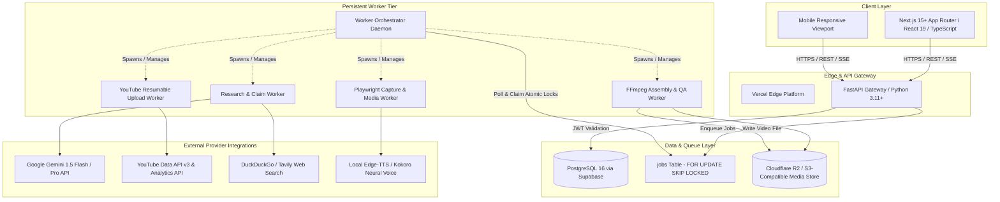
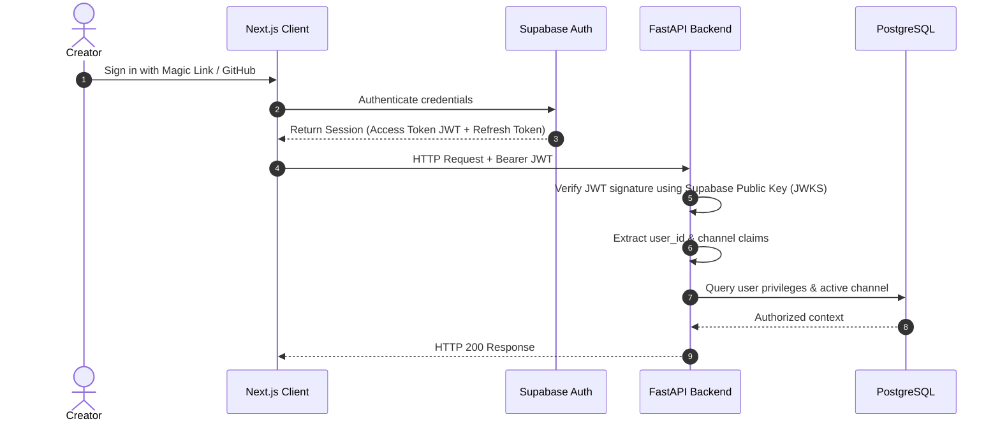
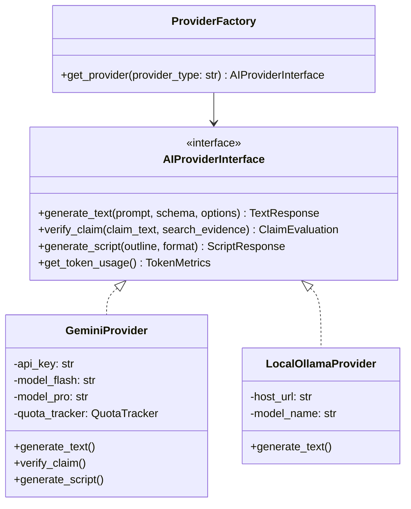
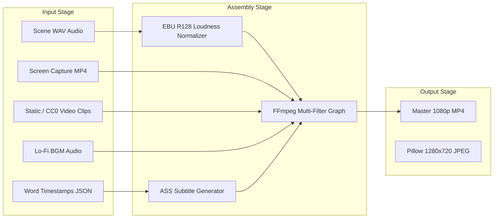
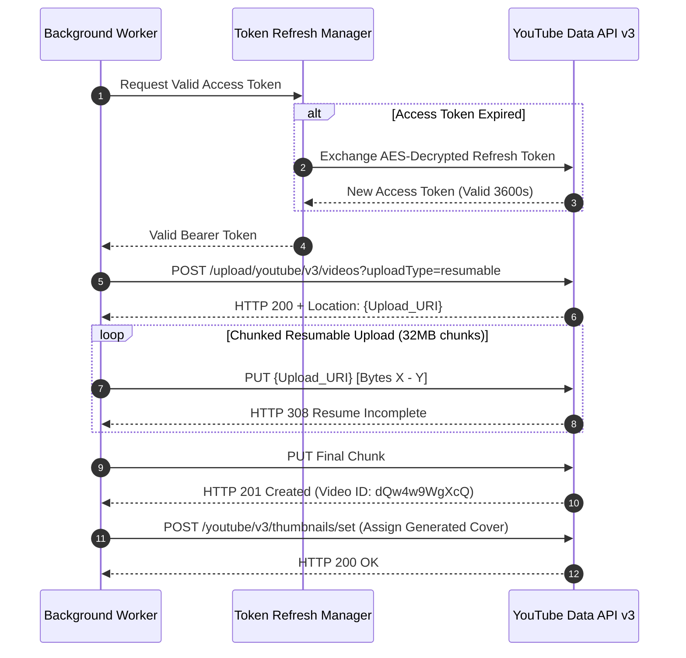
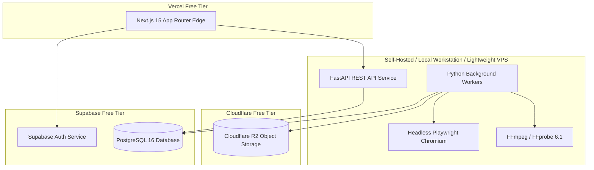

# Technical Requirements Document (TRD)
## Creator Studio AI — System Architecture & Engineering Specification

**Document Version:** 1.0.0  
**Status:** Approved for Backend & Infrastructure Implementation  
**Project Owner:** Muhammad Ali ([alibuild.site](https://alibuild.site))  

---

### Table of Contents
1. [System Architecture Overview](#1-system-architecture-overview)
2. [Technology Choices & Architectural Reasoning](#2-technology-choices--architectural-reasoning)
3. [Component Responsibilities & Boundaries](#3-component-responsibilities--boundaries)
4. [API Architecture & Contract Standards](#4-api-architecture--contract-standards)
5. [Frontend/Backend Communication Protocols](#5-frontendbackend-communication-protocols)
6. [Authentication & Authorization Architecture](#6-authentication--authorization-architecture)
7. [Database Architecture & Indexing Strategy](#7-database-architecture--indexing-strategy)
8. [AI Provider Abstraction Layer & Governance](#8-ai-provider-abstraction-layer--governance)
9. [Media Processing Architecture (FFmpeg, Playwright, TTS)](#9-media-processing-architecture-ffmpeg-playwright-tts)
10. [Background Worker Architecture (Durable PostgreSQL Queue)](#10-background-worker-architecture-durable-postgresql-queue)
11. [Storage Architecture (Local & Cloudflare R2)](#11-storage-architecture-local--cloudflare-r2)
12. [YouTube Data API Integration & Resumable Uploads](#12-youtube-data-api-integration--resumable-uploads)
13. [Analytics Ingestion Architecture](#13-analytics-ingestion-architecture)
14. [Security Architecture & Secrets Management](#14-security-architecture--secrets-management)
15. [Deployment Architecture & Infrastructure Blueprint](#15-deployment-architecture--infrastructure-blueprint)
16. [Scalability & Concurrency Model](#16-scalability--concurrency-model)
17. [Performance Engineering & Latency Targets](#17-performance-engineering--latency-targets)
18. [Logging, Telemetry & Observability](#18-logging-telemetry--observability)
19. [Disaster Recovery & Backup Strategy](#19-disaster-recovery--backup-strategy)
20. [Cost Optimization & Free-Tier Guardrails](#20-cost-optimization--free-tier-guardrails)

---

### 1. System Architecture Overview

Creator Studio AI employs a **decoupled distributed client-server architecture** designed for high reliability, deterministic execution, and zero operational cost during the initial phase.



---

### 2. Technology Choices & Architectural Reasoning

| Layer / Component | Technology Selected | Alternatives Considered | Justification & Architectural Reasoning |
|:---|:---|:---|:---|
| **Frontend Framework** | **Next.js 15 (App Router, React 19, TS)** | Vite SPA, Remix | Seamless SSR/SSG for dashboard performance, first-class TypeScript integration, zero-config deployment on Vercel free tier. |
| **Component System** | **shadcn/ui + Tailwind CSS** | Material UI, Chakra UI | Copy-paste source ownership, zero runtime overhead, unmatched styling flexibility for custom dark-first design system. |
| **Backend API Engine** | **FastAPI (Python 3.11+)** | Node.js (Express/Nest), Go | Python is the uncontested industry standard for AI SDKs, Playwright automation, FFmpeg bindings, and scientific data manipulation. High async throughput with `uvicorn`. |
| **ORM & Migrations** | **SQLAlchemy 2.0 (Async) + Alembic** | Prisma, Tortoise ORM | Industrial-grade maturity, complete async support, enterprise schema migration safety with Alembic. |
| **Primary Database** | **PostgreSQL 16 (via Supabase)** | MongoDB, SQLite | Relational integrity, ACID compliance, powerful JSONB querying for dynamic scene plans, and built-in row-level locking for worker queues. Generous free tier. |
| **Auth System** | **Supabase Auth + JWT Backend Verification** | Auth0, NextAuth / Auth.js | Eliminates duplicate user management tables, native OAuth handling for Google/GitHub, simple cryptographic JWT validation in FastAPI. |
| **Task Queue** | **PostgreSQL `FOR UPDATE SKIP LOCKED`** | Redis (BullMQ / Celery), RabbitMQ | Eliminates Redis hosting costs ($15+/mo). A single PostgreSQL table handles hundreds of jobs per day with bulletproof transaction safety. Redis can be introduced later if volume exceeds 1,000 jobs/day. |
| **Media Assembly** | **FFmpeg 6.x + FFprobe CLI** | Remotion, MoviePy | Maximum rendering performance, zero external licensing cost, universal codec support, hardware acceleration hooks (NVENC/QSV), and frame-exact audio filter graphs. |
| **Web Recording** | **Playwright (Python Async)** | Puppeteer, Selenium | Unrivaled headless browser stability, native video recording capabilities (`record_video_dir`), high-fidelity rendering of CSS animations, and robust isolation. |
| **Voice Synthesis** | **Edge-TTS / Kokoro-TTS (Local)** | ElevenLabs, Amazon Polly | ElevenLabs costs $22–$99/month. Edge-TTS delivers high-fidelity neural voices with zero API fees; Kokoro-82M provides local neural voice synthesis running directly on CPU. |
| **Object Storage** | **Cloudflare R2 (S3-Compatible)** | AWS S3, Google Cloud Storage | Zero egress bandwidth fees, 10 GB free storage monthly, S3-compatible API via `boto3` or `aioboto3`. |

---

### 3. Component Responsibilities & Boundaries

1. **Next.js Frontend:** UI presentation, form state, client-side validation, audio waveform visualization, video player, and real-time subscription to job state updates.
2. **FastAPI Gateway:** Exposes RESTful endpoints, enforces JWT authentication, handles rate limiting, validates Pydantic schemas, and writes job declarations to the database queue.
3. **Database Layer (Supabase PostgreSQL):** Stores structured entities, relational constraints, encrypted OAuth tokens, audit logs, and the durable task queue table.
4. **Queue & Worker Engine:** Independent Python process pool that claims tasks atomically, executes stage transitions, writes telemetry, and handles idempotent retries.
5. **AI Provider Abstraction:** Standardizes LLM requests, tracks token consumption in real time, manages rate limits, and routes between models.
6. **Media Synthesis Engine:** Sandboxed workers executing Playwright captures, audio mastering, kinetic subtitle compilation, and FFmpeg assembly.
7. **YouTube Publishing Agent:** Manages OAuth token refreshing, metadata payload formatting, chunked resumable media uploading, and publication scheduling.

---

### 4. API Architecture & Contract Standards

- **Protocol:** HTTP/2 over TLS 1.3.
- **Data Format:** Strictly JSON (`application/json`) for payloads; `multipart/form-data` for direct asset uploads.
- **URL Structure:** Resource-oriented RESTful URLs prefixed with `/api/v1/`.
- **Status Codes:**
  - `200 OK`: Request succeeded with body.
  - `201 Created`: Resource successfully created.
  - `202 Accepted`: Asynchronous job successfully enqueued.
  - `400 Bad Request`: Validation failure (includes Pydantic error details).
  - `401 Unauthorized`: Missing or invalid JWT.
  - `403 Forbidden`: Insufficient permissions.
  - `404 Not Found`: Resource does not exist.
  - `409 Conflict`: Idempotency collision or illegal state transition.
  - `429 Too Many Requests`: Rate or quota limit reached.
  - `500 Internal Server Error`: Unhandled server exception with tracked trace ID.

---

### 5. Frontend/Backend Communication Protocols

- **Command & Query (REST):** Standard CRUD operations executed via Next.js Server Actions or client-side `fetch` hooks.
- **Real-Time Job Telemetry (SSE):** Server-Sent Events endpoint `/api/v1/projects/{project_id}/progress-stream` pushes live percentage updates, stage changes, and worker heartbeat logs to the frontend video player and studio hubs.
- **Payload Validation:** Shared TypeScript interfaces generated from Pydantic OpenAPI schema using `openapi-typescript` to ensure end-to-end type parity.

---

### 6. Authentication & Authorization Architecture



- **Token Security:** Frontend stores JWT in secure, HTTP-only, SameSite cookies.
- **YouTube OAuth Token Security:** Refresh tokens are never sent to the browser. Tokens are encrypted at rest using **AES-256-GCM** via the Python `cryptography` library. Decryption occurs solely inside the background worker during active YouTube upload sessions.

---

### 7. Database Architecture & Indexing Strategy

- **Schema Engine:** Relational PostgreSQL with strict foreign keys and cascading delete rules where appropriate.
- **Concurrency Control:** Optimistic locking on mutable entities via `version` column; pessimistic row-level locking (`SELECT ... FOR UPDATE SKIP LOCKED`) on the background job queue.
- **Key Indexes:**
  - `CREATE INDEX idx_jobs_status_scheduled ON jobs (status, scheduled_at) WHERE status = 'QUEUED';`
  - `CREATE INDEX idx_projects_channel_state ON video_projects (channel_id, state);`
  - `CREATE INDEX idx_claims_project_verified ON script_claims (project_id, is_verified);`
  - `CREATE INDEX idx_usage_provider_date ON provider_usage (provider_name, recorded_at);`

---

### 8. AI Provider Abstraction Layer & Governance



#### Quota Sentinel & Budget Rules
- **Free Tier Policy:** Gemini free tier allows up to 15 Requests Per Minute (RPM) and 1,500 Requests Per Day (RPD).
- **Token Bucket Limiter:** Implemented via an in-memory/database rate limiter. If current minute requests reach 12 (80% threshold), the provider throttles outgoing requests with dynamic sleep intervals.
- **Hard Spend Ceilings:** If any paid API call is initiated and total month-to-date spend reaches the configured ceiling ($0.00 default), the provider immediately raises `BudgetExhaustionException` and marks active jobs as `PAUSED_BUDGET`.

---

### 9. Media Processing Architecture (FFmpeg, Playwright, TTS)



#### Media Pipeline Specifications
1. **Playwright Recording:**
   - Headless Chromium executed with `--disable-gpu`, `--no-sandbox`, `--window-size=1920,1080`.
   - Actions recorded at 60 fps to preserve smooth cursor movements and code typing animations.
2. **Audio Processing Filtergraph:**
   - Voiceover normalized via `loudnorm=I=-14:TP=-1.0:LRA=7`.
   - Background music sidechained with `acompressor` to automatically duck by 18 dB whenever speech frequencies are detected.
3. **Kinetic Typography:**
   - Advanced SubStation Alpha (`.ass`) file generation containing custom font tags, active-word orange highlighting (`{\c&H007AFF&}` in BGR format), and bounce keyframes.
4. **Encoding Parameters:**
   - `-c:v libx264 -preset medium -crf 20 -pix_fmt yuv420p -c:a aac -b:a 192k -ar 48000 -movflags +faststart`.

---

### 10. Background Worker Architecture (Durable PostgreSQL Queue)

- **Worker Process:** Python standalone service utilizing `asyncio`.
- **Atomic Job Claiming Query:**
```sql
WITH next_job AS (
  SELECT id FROM jobs
  WHERE status = 'QUEUED' 
    AND (scheduled_at IS NULL OR scheduled_at <= NOW())
  ORDER BY priority DESC, created_at ASC
  LIMIT 1
  FOR UPDATE SKIP LOCKED
)
UPDATE jobs
SET status = 'PROCESSING',
    locked_by = :worker_id,
    locked_at = NOW(),
    updated_at = NOW(),
    attempt_count = attempt_count + 1
FROM next_job
WHERE jobs.id = next_job.id
RETURNING jobs.*;
```
- **Heartbeat & Zombie Recovery:** Workers update `jobs.heartbeat_at` every 15 seconds. An automated watchdog daemon queries for jobs where `status = 'PROCESSING'` and `heartbeat_at < NOW() - INTERVAL '2 minutes'`, resetting them to `QUEUED` or `FAILED` if retry limits are exceeded.
- **Idempotency Strategy:** Every job carries an `idempotency_key` constructed as `sha256(project_id + stage + revision_number)`. Duplicate job submissions are rejected at the database level.

---

### 11. Storage Architecture (Local & Cloudflare R2)

- **Development Mode:** Media files are written to local disk at `./storage/{channel_id}/{project_id}/`.
- **Production Mode:** Media files are uploaded to Cloudflare R2 via async S3 clients (`aioboto3`).
- **Bucket Hierarchy:**
  - `/{channel_id}/projects/{project_id}/audio/` (WAV scenes & mastered vocal track)
  - `/{channel_id}/projects/{project_id}/raw_captures/` (Playwright MP4 screencasts)
  - `/{channel_id}/projects/{project_id}/renders/` (Final assembled video files)
  - `/{channel_id}/projects/{project_id}/thumbnails/` (1280x720 PNG/JPEG variants)
- **Lifecycle Rules:** Raw browser captures are marked for automatic deletion 14 days after successful YouTube publication to conserve storage limits.

---

### 12. YouTube Data API Integration & Resumable Uploads



- **Upload Safety:** All uploads initially set `privacyStatus = "unlisted"` or `"private"`. If scheduled, `publishAt` is passed as an ISO 8601 string.
- **Synthetic Content Tag:** Requests explicitly include `syntheticMedia: true` in the YouTube upload metadata.

---

### 13. Analytics Ingestion Architecture

- **Cadence:** Analytics worker runs every 12 hours.
- **Endpoints Queried:**
  - YouTube Data API v3 (`videos.list` for view counts, likes, comments).
  - YouTube Analytics API (`reports.query` for Average View Duration, Estimated Minutes Watched, and Impression CTR).
- **Data Persistence:** Records written to `analytics_snapshots` table with timestamped snapshots.
- **Feedback Loop:** Tag retention weights are recomputed and stored in `channel_settings.topic_weights` to bias future topic scoring.

---

### 14. Security Architecture & Secrets Management

1. **Zero Secret Exposure:** No API keys or OAuth refresh tokens are accessible from the frontend client.
2. **At-Rest Encryption:** OAuth refresh tokens and external API keys are encrypted via `AES-256-GCM` using a 32-byte master key stored in an OS-level environment variable (`APP_MASTER_ENCRYPTION_KEY`).
3. **CORS Enforcement:** FastAPI restricts CORS strictly to the deployed Next.js domain (e.g., `https://creatorstudio.alibuild.site`).
4. **Input Sanitization:** Playwright automation does not execute untrusted user code; it executes strictly structured JSON instructions (e.g., `{ action: "type", selector: "#code", value: "print('hello')" }`).
5. **Rate Limiting:** FastAPI implements rate limiting via slowapi (100 requests/minute per authenticated user).

---

### 15. Deployment Architecture & Infrastructure Blueprint



- **Frontend:** Deployed to Vercel (Free Hobby Tier).
- **Database & Auth:** Deployed to Supabase (Free Tier, 500MB storage, 50,000 MAU).
- **Media & Workers:** Runs on Muhammad Ali's local Windows workstation during development, with automated scripts to start FastAPI and worker daemons; can be packaged into a Docker container for deployment to a low-cost VPS (e.g., Hetzner or Render) when scaling.

---

### 16. Scalability & Concurrency Model

- **Worker Concurrency Throttling:** Due to local CPU and memory constraints, the rendering worker is limited to **1 concurrent FFmpeg process** to prevent system lockups.
- **Non-CPU Bound Concurrency:** Research, claim verification, and YouTube upload workers execute with concurrency up to 5 tasks via `asyncio`.
- **Database Connection Pooling:** SQLAlchemy async pool configured with `pool_size=10`, `max_overflow=5` to respect Supabase free-tier connection limits (60 max connections).

---

### 17. Performance Engineering & Latency Targets

| Operation | Target $P_{50}$ | Target $P_{95}$ | Optimization Technique |
|:---|:---|:---|:---|
| Dashboard API Response | 45 ms | 120 ms | Indexed queries, selective column fetching. |
| Gemini Script Generation | 4.5 s | 8.0 s | Stream processing, compact structured prompts. |
| Local TTS Generation (Scene) | 800 ms | 1.8 s | Edge-TTS streaming audio chunks to disk. |
| FFmpeg Full Render (8 min) | 6.0 min | 9.0 min | Hardware acceleration where available, ultrafast intermediate passes. |
| Resumable YouTube Upload | Dependent on bandwidth | Chunked 32MB uploads with automatic retry. |

---

### 18. Logging, Telemetry & Observability

- **Structured Logging:** Standardized JSON log output via Python `structlog` containing `timestamp`, `level`, `service`, `project_id`, `job_id`, and `message`.
- **Worker Heartbeat Tracking:** Real-time logging of worker CPU and memory usage into `system_health` table.
- **Trace Context:** Every user action generates a `trace_id` propagated through REST calls to background worker tasks for end-to-end debugging.

---

### 19. Disaster Recovery & Backup Strategy

- **Database Backups:** Daily automated PostgreSQL logical dumps via Supabase.
- **State Recovery on Crash:** If a worker machine reboots mid-render:
  1. The watchdog daemon detects expired heartbeats.
  2. The incomplete project is moved back to the previous stable state checkpoint (e.g., `VISUALS_GENERATING`).
  3. Temporary disk files are wiped, and the task restarts cleanly without corrupting downstream tables.

---

### 20. Cost Optimization & Free-Tier Guardrails

- **Zero-Dollar Budget Enforcement:** System operates completely within free allowances by default:
  - Google AI Studio (Gemini 1.5 Flash free tier: 15 RPM / 1,500 RPD).
  - Supabase (Free tier PostgreSQL).
  - Cloudflare R2 (10 GB free storage, $0 egress).
  - Edge-TTS / Kokoro (Free local voice synthesis).
- **Proactive Circuit Breakers:** If API bills exceed $0.01 without explicit user approval, all automated worker triggers are disarmed immediately.
