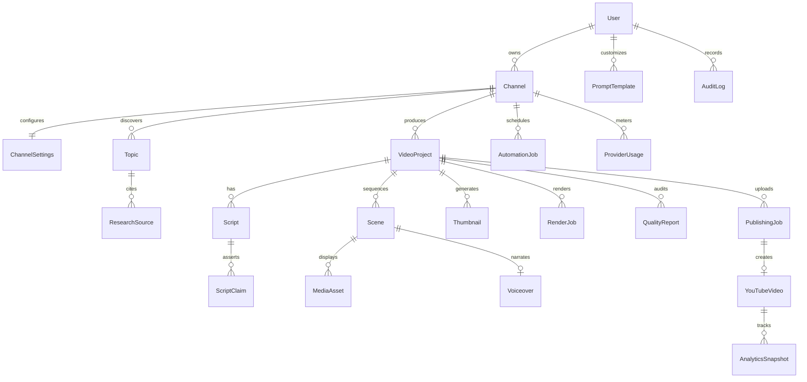
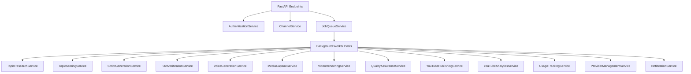

# Backend Architecture & Implementation Blueprint
## Creator Studio AI — Database, Services & State Machine Specification

**Document Version:** 1.0.0  
**Status:** Approved for Database Migration & Backend Implementation  
**Project Owner:** Muhammad Ali ([alibuild.site](https://alibuild.site))  

---

### Table of Contents
1. [Architectural Overview & Data Flow](#1-architectural-overview--data-flow)
2. [Complete Database Schema (21 Relational Models)](#2-complete-database-schema-21-relational-models)
3. [Comprehensive Backend Services (21 Services)](#3-comprehensive-backend-services-21-services)
4. [Durable Job Queue & Worker Engine](#4-durable-job-queue--worker-engine)
5. [Production State Machine & Transition Rules](#5-production-state-machine--transition-rules)
6. [Complete REST API Contract & Payloads](#6-complete-rest-api-contract--payloads)
7. [Enterprise Security & Secret Protection](#7-enterprise-security--secret-protection)

---

### 1. Architectural Overview & Data Flow

The backend of **Creator Studio AI** is implemented in **Python 3.11+ using FastAPI, SQLAlchemy 2.0 (Async), Alembic, and Pydantic v2**. 

It provides:
1. **Durable Task Processing:** A transactional queue stored directly in PostgreSQL, eliminating Redis dependencies for initial operation.
2. **State Machine Integrity:** Strict, verifiable state progression where invalid transitions are rejected.
3. **Decoupled Engine Services:** Specialized domain services responsible for research, scripting, audio mastering, headless capture, and FFmpeg assembly.
4. **Resilient Third-Party Integrations:** Resumable YouTube Data API uploads, rate-limited Gemini LLM execution, and headless Playwright demonstration recording.

---

### 2. Complete Database Schema (21 Relational Models)

All models include `created_at TIMESTAMP WITH TIME ZONE DEFAULT NOW()` and `updated_at TIMESTAMP WITH TIME ZONE DEFAULT NOW()`. UUIDs are primary keys (`uuid_generate_v4()`).



#### Model 1: `User`
- **Fields:**
  - `id` (UUID, PK)
  - `supabase_user_id` (VARCHAR(128), UNIQUE, NOT NULL, INDEX)
  - `email` (VARCHAR(255), UNIQUE, NOT NULL)
  - `full_name` (VARCHAR(255), NULL)
  - `role` (VARCHAR(32), DEFAULT 'OWNER')
- **Constraints & Indexes:** `uq_users_supabase_id`, `uq_users_email`.

#### Model 2: `Channel`
- **Fields:**
  - `id` (UUID, PK)
  - `user_id` (UUID, FK -> `User.id`, ON DELETE CASCADE)
  - `youtube_channel_id` (VARCHAR(128), UNIQUE, NOT NULL, INDEX)
  - `title` (VARCHAR(255), NOT NULL)
  - `description` (TEXT, NULL)
  - `custom_url` (VARCHAR(128), NULL)
  - `thumbnail_url` (TEXT, NULL)
  - `subscriber_count` (BIGINT, DEFAULT 0)
  - `oauth_refresh_token_encrypted` (TEXT, NOT NULL)
  - `token_expires_at` (TIMESTAMP WITH TIME ZONE, NULL)
  - `is_active` (BOOLEAN, DEFAULT TRUE)

#### Model 3: `ChannelSettings`
- **Fields:**
  - `id` (UUID, PK)
  - `channel_id` (UUID, UNIQUE, FK -> `Channel.id`, ON DELETE CASCADE)
  - `niche_keywords` (JSONB, DEFAULT '[]'::jsonb)
  - `default_privacy` (VARCHAR(32), DEFAULT 'unlisted')
  - `default_category_id` (VARCHAR(16), DEFAULT '28') -- 28: Science & Technology
  - `weekly_cadence_long` (INTEGER, DEFAULT 2)
  - `weekly_cadence_shorts` (INTEGER, DEFAULT 3)
  - `auto_publish_enabled` (BOOLEAN, DEFAULT FALSE)
  - `max_monthly_spend_usd` (NUMERIC(8,2), DEFAULT 0.00)
  - `topic_retention_weights` (JSONB, DEFAULT '{}'::jsonb)

#### Model 4: `Topic`
- **Fields:**
  - `id` (UUID, PK)
  - `channel_id` (UUID, FK -> `Channel.id`, ON DELETE CASCADE)
  - `title` (VARCHAR(512), NOT NULL)
  - `niche_category` (VARCHAR(128), NOT NULL)
  - `opportunity_score` (NUMERIC(5,2), NOT NULL) -- 0.00 to 100.00
  - `search_volume_score` (NUMERIC(5,2), DEFAULT 0.00)
  - `competition_score` (NUMERIC(5,2), DEFAULT 0.00)
  - `status` (VARCHAR(32), DEFAULT 'DISCOVERED', INDEX) -- DISCOVERED, SELECTED, ARCHIVED
  - `raw_discovery_payload` (JSONB, NULL)

#### Model 5: `ResearchSource`
- **Fields:**
  - `id` (UUID, PK)
  - `topic_id` (UUID, FK -> `Topic.id`, ON DELETE CASCADE)
  - `source_url` (TEXT, NOT NULL)
  - `source_title` (VARCHAR(512), NULL)
  - `extracted_summary` (TEXT, NOT NULL)
  - `relevance_score` (NUMERIC(4,3), DEFAULT 1.000)

#### Model 6: `VideoProject`
- **Fields:**
  - `id` (UUID, PK)
  - `channel_id` (UUID, FK -> `Channel.id`, ON DELETE CASCADE)
  - `topic_id` (UUID, FK -> `Topic.id`, NULL, ON DELETE SET NULL)
  - `title` (VARCHAR(255), NOT NULL)
  - `format` (VARCHAR(32), DEFAULT 'LONG_FORM') -- LONG_FORM, SHORTS
  - `state` (VARCHAR(64), DEFAULT 'IDEA', INDEX)
  - `target_duration_seconds` (INTEGER, DEFAULT 480)
  - `actual_duration_seconds` (NUMERIC(8,2), NULL)
  - `revision_number` (INTEGER, DEFAULT 1)
  - `published_at` (TIMESTAMP WITH TIME ZONE, NULL)

#### Model 7: `Script`
- **Fields:**
  - `id` (UUID, PK)
  - `project_id` (UUID, FK -> `VideoProject.id`, ON DELETE CASCADE)
  - `version` (INTEGER, DEFAULT 1)
  - `full_text` (TEXT, NOT NULL)
  - `word_count` (INTEGER, NOT NULL)
  - `estimated_duration_seconds` (INTEGER, NOT NULL)
  - `is_locked` (BOOLEAN, DEFAULT FALSE)

#### Model 8: `ScriptClaim`
- **Fields:**
  - `id` (UUID, PK)
  - `script_id` (UUID, FK -> `Script.id`, ON DELETE CASCADE)
  - `project_id` (UUID, FK -> `VideoProject.id`, ON DELETE CASCADE)
  - `claim_text` (TEXT, NOT NULL)
  - `extracted_entity` (VARCHAR(255), NULL)
  - `claim_type` (VARCHAR(64), NOT NULL) -- BENCHMARK, PRICING, RELEASE_DATE, FEATURE
  - `is_verified` (BOOLEAN, DEFAULT FALSE)
  - `confidence_score` (NUMERIC(4,3), DEFAULT 0.000)
  - `citation_url` (TEXT, NULL)
  - `citation_snippet` (TEXT, NULL)

#### Model 9: `Storyboard` (Added M08)
- **Fields:**
  - `id` (UUID, PK)
  - `project_id` (UUID, FK -> `VideoProject.id`, ON DELETE CASCADE)
  - `script_id` (UUID, FK -> `Script.id`, ON DELETE SET NULL)
  - `narration_track_id` (UUID, FK -> `NarrationTrack.id`, ON DELETE SET NULL)
  - `version` (INTEGER, DEFAULT 1)
  - `status` (VARCHAR(32), DEFAULT 'DRAFT') -- DRAFT, IN_REVIEW, APPROVED
  - `aspect_ratio` (VARCHAR(16), DEFAULT '16:9') -- 16:9, 9:16
  - `scene_count` (INTEGER, DEFAULT 0)
  - `approved_scene_count` (INTEGER, DEFAULT 0)

#### Model 10: `Scene` (Enhanced M08)
- **Fields:**
  - `id` (UUID, PK)
  - `project_id` (UUID, FK -> `VideoProject.id`, ON DELETE CASCADE)
  - `storyboard_id` (UUID, FK -> `Storyboard.id`, ON DELETE CASCADE)
  - `scene_order` (INTEGER, NOT NULL)
  - `narration_text` (TEXT, NOT NULL)
  - `visual_archetype` (VARCHAR(64), NOT NULL) -- BROWSER_CAPTURE, CODE_TERMINAL, INFOGRAPHIC, BROLL
  - `visual_directive` (TEXT, NOT NULL)
  - `visual_purpose` (VARCHAR(64), DEFAULT 'CONCEPT_EXPLANATION') -- HOOK_ENGAGEMENT, DEMONSTRATION, CONCEPT_EXPLANATION, SUMMARY
  - `suggested_asset_type` (VARCHAR(64), DEFAULT 'GENERATED_IMAGE') -- CODE_DEMONSTRATION, SOFTWARE_INTERFACE, DIAGRAM, CHART, STOCK_FOOTAGE, GENERATED_IMAGE
  - `search_keywords` (JSON, DEFAULT '[]')
  - `image_prompt` (TEXT, NULL)
  - `transition` (VARCHAR(32), DEFAULT 'CUT') -- CUT, FADE, ZOOM_IN, PAN_RIGHT, SLIDE_LEFT
  - `review_status` (VARCHAR(32), DEFAULT 'DRAFT') -- DRAFT, SUGGESTED, APPROVED, REJECTED
  - `target_url` (TEXT, NULL)
  - `duration_seconds` (NUMERIC(6,2), NOT NULL)
  - `selected_asset_id` (UUID, FK -> `MediaAsset.id`, ON DELETE SET NULL)

#### Model 11: `MediaAsset` (Enhanced M08)
- **Fields:**
  - `id` (UUID, PK)
  - `channel_id` (UUID, FK -> `Channel.id`, ON DELETE CASCADE)
  - `project_id` (UUID, FK -> `VideoProject.id`, ON DELETE CASCADE)
  - `scene_id` (UUID, FK -> `Scene.id`, ON DELETE SET NULL)
  - `title` (VARCHAR(255), NOT NULL)
  - `description` (TEXT, NULL)
  - `asset_type` (VARCHAR(32), NOT NULL) -- VIDEO_CAPTURE, IMAGE, BROLL, CODE_WIDGET
  - `asset_category` (VARCHAR(64), NOT NULL) -- GENERATED, EXTERNAL_STOCK, USER_UPLOADED, SCREENSHOT, DIAGRAM, ILLUSTRATION, BROLL
  - `source_provider` (VARCHAR(64), NOT NULL) -- MOCK, PEXELS, PIXABAY, UNSPLASH, GEMINI_IMAGEN, USER_UPLOAD
  - `source_url` (TEXT, NULL)
  - `preview_url` (TEXT, NULL)
  - `author_name` (VARCHAR(255), NULL)
  - `author_url` (TEXT, NULL)
  - `license_type` (VARCHAR(64), NOT NULL) -- RECORDED_DEMO, CC0, PEXELS_FREE, PIXABAY_FREE, UNSPLASH_FREE, CUSTOM
  - `license_status` (VARCHAR(64), NOT NULL) -- VERIFIED_COMMERCIAL, ATTRIBUTION_REQUIRED, LICENSE_REVIEW_REQUIRED, RESTRICTED
  - `attribution_text` (TEXT, NULL)
  - `aspect_ratio` (VARCHAR(16), NOT NULL) -- 16:9, 9:16, 1:1, CUSTOM
  - `width` (INTEGER, NULL)
  - `height` (INTEGER, NULL)
  - `mime_type` (VARCHAR(64), DEFAULT 'image/png')
  - `duration_seconds` (NUMERIC(8,2), NULL)
  - `storage_path` (TEXT, NOT NULL)
  - `file_size_bytes` (BIGINT, NOT NULL)
  - `sha256_hash` (VARCHAR(64), NOT NULL)
  - `is_verified` (BOOLEAN, DEFAULT TRUE)
  - `is_archived` (BOOLEAN, DEFAULT FALSE)

#### Model 11: `Voiceover`
- **Fields:**
  - `id` (UUID, PK)
  - `scene_id` (UUID, UNIQUE, FK -> `Scene.id`, ON DELETE CASCADE)
  - `project_id` (UUID, FK -> `VideoProject.id`, ON DELETE CASCADE)
  - `tts_engine` (VARCHAR(64), NOT NULL) -- EDGE_TTS, KOKORO_LOCAL, PIPER
  - `voice_id` (VARCHAR(128), NOT NULL)
  - `audio_storage_path` (TEXT, NOT NULL)
  - `duration_seconds` (NUMERIC(6,3), NOT NULL)
  - `word_timestamps` (JSONB, NOT NULL) -- [{ word, start, end }]
  - `loudness_lufs` (NUMERIC(4,2), NOT NULL)

#### Model 12: `Thumbnail`
- **Fields:**
  - `id` (UUID, PK)
  - `project_id` (UUID, FK -> `VideoProject.id`, ON DELETE CASCADE)
  - `variant_code` (VARCHAR(16), NOT NULL) -- A, B, C
  - `storage_path` (TEXT, NOT NULL)
  - `headline_text` (VARCHAR(128), NOT NULL)
  - `accent_color_hex` (VARCHAR(16), NOT NULL)
  - `is_selected` (BOOLEAN, DEFAULT FALSE)

#### Model 13: `RenderJob`
- **Fields:**
  - `id` (UUID, PK)
  - `project_id` (UUID, FK -> `VideoProject.id`, ON DELETE CASCADE)
  - `resolution` (VARCHAR(32), DEFAULT '1080p')
  - `output_video_path` (TEXT, NULL)
  - `render_duration_seconds` (NUMERIC(8,2), NULL)
  - `ffmpeg_command_executed` (TEXT, NULL)
  - `status` (VARCHAR(32), DEFAULT 'QUEUED') -- QUEUED, PROCESSING, COMPLETED, FAILED
  - `error_message` (TEXT, NULL)

#### Model 14: `QualityReport`
- **Fields:**
  - `id` (UUID, PK)
  - `project_id` (UUID, FK -> `VideoProject.id`, ON DELETE CASCADE)
  - `render_job_id` (UUID, FK -> `RenderJob.id`, ON DELETE CASCADE)
  - `all_checks_passed` (BOOLEAN, NOT NULL)
  - `black_frame_duration_max` (NUMERIC(6,3), NOT NULL)
  - `freeze_duration_max` (NUMERIC(6,3), NOT NULL)
  - `integrated_loudness_lufs` (NUMERIC(4,2), NOT NULL)
  - `max_true_peak_dbtp` (NUMERIC(4,2), NOT NULL)
  - `unverified_claims_count` (INTEGER, NOT NULL)
  - `transcript_similarity_ratio` (NUMERIC(4,3), NOT NULL)
  - `diagnostic_details` (JSONB, NOT NULL)

#### Model 15: `PublishingJob`
- **Fields:**
  - `id` (UUID, PK)
  - `project_id` (UUID, FK -> `VideoProject.id`, ON DELETE CASCADE)
  - `channel_id` (UUID, FK -> `Channel.id`, ON DELETE CASCADE)
  - `scheduled_publish_time` (TIMESTAMP WITH TIME ZONE, NULL)
  - `privacy_status` (VARCHAR(32), DEFAULT 'unlisted')
  - `synthetic_media_declared` (BOOLEAN, DEFAULT TRUE)
  - `status` (VARCHAR(32), DEFAULT 'PENDING') -- PENDING, UPLOADING, COMPLETED, FAILED

#### Model 16: `YouTubeVideo`
- **Fields:**
  - `id` (UUID, PK)
  - `publishing_job_id` (UUID, UNIQUE, FK -> `PublishingJob.id`, ON DELETE CASCADE)
  - `project_id` (UUID, FK -> `VideoProject.id`, ON DELETE CASCADE)
  - `youtube_video_id` (VARCHAR(64), UNIQUE, NOT NULL, INDEX)
  - `published_video_url` (TEXT, NOT NULL)
  - `view_count` (BIGINT, DEFAULT 0)
  - `like_count` (BIGINT, DEFAULT 0)
  - `comment_count` (BIGINT, DEFAULT 0)

#### Model 17: `AnalyticsSnapshot`
- **Fields:**
  - `id` (UUID, PK)
  - `youtube_video_id` (VARCHAR(64), FK -> `YouTubeVideo.youtube_video_id`, ON DELETE CASCADE)
  - `snapshot_time` (TIMESTAMP WITH TIME ZONE, NOT NULL, INDEX)
  - `views` (BIGINT, NOT NULL)
  - `watch_time_minutes` (NUMERIC(10,2), NOT NULL)
  - `average_view_duration_seconds` (NUMERIC(8,2), NOT NULL)
  - `click_through_rate` (NUMERIC(5,4), NOT NULL)
  - `retention_at_30s` (NUMERIC(5,4), NOT NULL)

#### Model 18: `AutomationJob` (Persistent Job Queue)
- **Fields:**
  - `id` (UUID, PK)
  - `channel_id` (UUID, FK -> `Channel.id`, ON DELETE CASCADE)
  - `job_type` (VARCHAR(64), NOT NULL, INDEX) -- DISCOVER_TOPICS, SCRIPT, CAPTURE, RENDER, QA, UPLOAD
  - `payload` (JSONB, NOT NULL)
  - `idempotency_key` (VARCHAR(128), UNIQUE, NOT NULL, INDEX)
  - `status` (VARCHAR(32), DEFAULT 'QUEUED', INDEX) -- QUEUED, PROCESSING, COMPLETED, FAILED, RETRYING
  - `priority` (INTEGER, DEFAULT 10)
  - `scheduled_at` (TIMESTAMP WITH TIME ZONE, NULL)
  - `attempt_count` (INTEGER, DEFAULT 0)
  - `max_retries` (INTEGER, DEFAULT 3)
  - `locked_by` (VARCHAR(128), NULL)
  - `locked_at` (TIMESTAMP WITH TIME ZONE, NULL)
  - `heartbeat_at` (TIMESTAMP WITH TIME ZONE, NULL)
  - `progress_percentage` (INTEGER, DEFAULT 0)
  - `error_log` (TEXT, NULL)

#### Model 19: `ProviderUsage`
- **Fields:**
  - `id` (UUID, PK)
  - `channel_id` (UUID, FK -> `Channel.id`, ON DELETE CASCADE)
  - `provider_name` (VARCHAR(64), NOT NULL, INDEX) -- GEMINI_FLASH, GEMINI_PRO, SEARCH_API
  - `model_name` (VARCHAR(128), NOT NULL)
  - `input_tokens` (INTEGER, DEFAULT 0)
  - `output_tokens` (INTEGER, DEFAULT 0)
  - `cost_usd` (NUMERIC(8,6), DEFAULT 0.000000)
  - `recorded_at` (TIMESTAMP WITH TIME ZONE, DEFAULT NOW(), INDEX)

#### Model 20: `PromptTemplate`
- **Fields:**
  - `id` (UUID, PK)
  - `template_key` (VARCHAR(64), UNIQUE, NOT NULL) -- SCRIPT_LONG_FORM, FACT_CHECK, THUMBNAIL_HOOKS
  - `system_prompt` (TEXT, NOT NULL)
  - `user_prompt_template` (TEXT, NOT NULL)
  - `schema_definition` (JSONB, NOT NULL)
  - `version` (VARCHAR(16), DEFAULT 'v1.0.0')

#### Model 21: `AuditLog`
- **Fields:**
  - `id` (UUID, PK)
  - `user_id` (UUID, FK -> `User.id`, NULL, ON DELETE SET NULL)
  - `action` (VARCHAR(128), NOT NULL, INDEX)
  - `resource_type` (VARCHAR(64), NOT NULL)
  - `resource_id` (UUID, NOT NULL)
  - `ip_address` (VARCHAR(64), NULL)
  - `details` (JSONB, NOT NULL)

---

### 3. Comprehensive Backend Services (21 Services)



1. **AuthenticationService:** Validates Supabase JWTs, extracts user claims, verifies user status, and manages session state.
2. **UserService:** Handles user registration, profile updates, and role-based permissions.
3. **ChannelService:** Manages YouTube OAuth token storage, AES-256 encryption/decryption, channel metadata queries, and upload defaults.
4. **TopicResearchService:** Ingests RSS feeds, Reddit, and GitHub endpoints; deduplicates raw concepts against previously published video topics.
5. **TopicScoringService:** Runs scoring algorithms evaluating search volume, niche alignment, and novelty; computes opportunity score (0–100).
6. **ScriptGenerationService:** Calls Gemini structured output prompts to generate 5-stage long-form or shorts scripts with scene breakdowns.
7. **FactVerificationService:** Extracts factual claims, queries search APIs, and assigns confidence scores; triggers targeted rewrites for claims < 0.80.
8. **ScenePlanningService:** Converts approved scripts into visual manifests, mapping sentences to visual archetypes (`BROWSER_CAPTURE`, `CODE_TERMINAL`, etc.).
9. **VoiceGenerationService:** Executes local neural TTS (Edge-TTS / Kokoro), normalizes loudness to -14 LUFS, and extracts phoneme/word-level timestamps.
10. **VisualAssetService:** Retrieves Creative Commons / Pexels b-roll, verifies SHA-256 hashes, and tracks licensing records.
11. **MediaCaptureService:** Launches Playwright headless Chromium instances, runs scripted interactions on target URLs, and records 1080p 60fps MP4 video.
12. **VideoRenderingService:** Procedurally generates ASS subtitles, builds complex FFmpeg multi-filter graphs, ducks background music, and renders master MP4 files.
13. **ThumbnailService:** Uses Pillow to compose 1280x720 graphical thumbnails in 3 contrasting variants with bold typography and glowing accents.
14. **QualityAssuranceService:** Executes the 14-point deterministic QA audit (black frames, loudness, frozen video, claim coverage) and generates signed `QualityReport` records.
15. **YouTubePublishingService:** Manages chunked resumable media uploading via YouTube Data API v3, sets metadata, thumbnails, and privacy schedules.
16. **YouTubeAnalyticsService:** Polls YouTube Data and Analytics APIs at +24h, +48h, and +7d to ingest view, retention, and CTR telemetry.
17. **JobQueueService:** Manages atomic job claiming via `FOR UPDATE SKIP LOCKED`, heartbeats, retries with exponential backoff, and dead-letter handling.
18. **AutomationSchedulerService:** Evaluates weekly channel cadences (e.g., 2 Long, 3 Shorts) and enqueues automated discovery and production jobs.
19. **ProviderManagementService:** Routes requests across Gemini, Search, and TTS providers; manages token rate-limiting and model switching.
20. **UsageTrackingService:** Meters input/output tokens and estimated costs; halts worker operations if hard budget caps are exceeded.
21. **NotificationService:** Dispatches real-time SSE progress events to the frontend client and records system alerts for QA vetoes.

---

### 4. Durable Job Queue & Worker Engine

#### Worker Loop Execution Flow
```python
# Conceptual loop in python worker daemon
while is_running:
    job = await job_queue_service.claim_next_job(worker_id="worker_01")
    if not job:
        await asyncio.sleep(2.0)
        continue
    
    try:
        # Start background heartbeat task
        heartbeat_task = asyncio.create_task(send_heartbeats(job.id))
        
        # Route and execute job
        await execute_pipeline_job(job)
        
        await job_queue_service.mark_complete(job.id)
    except TransientException as e:
        await job_queue_service.mark_retry(job.id, str(e), backoff_seconds=2 ** job.attempt_count * 30)
    except HardFailureException as e:
        await job_queue_service.mark_failed(job.id, str(e))
    finally:
        heartbeat_task.cancel()
```

---

### 5. Production State Machine & Transition Rules

```
Valid State Transitions:
IDEA                -> RESEARCHING, CANCELLED
RESEARCHING         -> PLANNED, FAILED
PLANNED             -> SCRIPTING, CANCELLED
SCRIPTING           -> FACT_CHECKING, FAILED
FACT_CHECKING       -> VOICE_GENERATING, NEEDS_ATTENTION, FAILED
VOICE_GENERATING    -> VISUALS_GENERATING, FAILED
VISUALS_GENERATING  -> RENDERING, FAILED
RENDERING           -> QUALITY_CHECK, FAILED
QUALITY_CHECK       -> READY_TO_PUBLISH (if all passed), NEEDS_ATTENTION (if any check failed)
NEEDS_ATTENTION     -> SCRIPTING, RENDERING, CANCELLED (manual resolution)
READY_TO_PUBLISH    -> UPLOADING, CANCELLED
UPLOADING           -> SCHEDULED, PUBLISHED, FAILED
SCHEDULED           -> PUBLISHED, CANCELLED
PUBLISHED           -> [TERMINAL]
FAILED              -> IDEA, PLANNED (manual restart)
CANCELLED           -> [TERMINAL]
```

---

### 6. Complete REST API Contract & Payloads

#### Selected Core Endpoints

##### 1. POST `/api/v1/projects`
- **Request:**
```json
{
  "channel_id": "3fa85f64-5717-4562-b3fc-2c963f66afa6",
  "topic_id": "c3d4e5f6-a7b8-4c9d-0e1f-2a3b4c5d6e7f",
  "title": "Top 3 Open Source AI Coding Assistants in 2026",
  "format": "LONG_FORM",
  "target_duration_seconds": 480
}
```
- **Response (201 Created):**
```json
{
  "id": "7a8b9c0d-1e2f-3a4b-5c6d-7e8f9a0b1c2d",
  "state": "IDEA",
  "title": "Top 3 Open Source AI Coding Assistants in 2026",
  "created_at": "2026-11-07T17:40:00Z"
}
```

##### 2. POST `/api/v1/projects/{id}/transition`
- **Request:**
```json
{
  "target_state": "SCRIPTING",
  "parameters": {
    "tone": "authoritative_developer",
    "pacing": "fast"
  }
}
```
- **Response (202 Accepted):**
```json
{
  "project_id": "7a8b9c0d-1e2f-3a4b-5c6d-7e8f9a0b1c2d",
  "enqueued_job_id": "e1f2a3b4-c5d6-4e7f-8a9b-0c1d2e3f4a5b",
  "status": "QUEUED"
}
```

##### 3. GET `/api/v1/projects/{id}/qa-report`
- **Response (200 OK):**
```json
{
  "project_id": "7a8b9c0d-1e2f-3a4b-5c6d-7e8f9a0b1c2d",
  "all_checks_passed": true,
  "metrics": {
    "black_frame_duration_max": 0.0,
    "freeze_duration_max": 0.5,
    "integrated_loudness_lufs": -13.9,
    "max_true_peak_dbtp": -1.2,
    "unverified_claims_count": 0,
    "transcript_similarity_ratio": 0.12
  },
  "checks": [
    { "name": "black_frame_detector", "passed": true, "details": "No frames below 10% lum threshold" },
    { "name": "loudness_normalizer", "passed": true, "details": "-13.9 LUFS within target (-14 +- 1.5)" }
  ]
}
```

---

### 7. Enterprise Security & Secret Protection

1. **OAuth Refresh Token Encryption:**
   - Keys are encrypted before database insertion using AES-256-GCM.
   - The cipher text is formatted as `nonce (12 bytes) + tag (16 bytes) + ciphertext`.
   - The master key is held exclusively in memory via `APP_MASTER_ENCRYPTION_KEY`.
2. **Deterministic Playwright Isolation:**
   - Playwright instances run with `--disable-web-security=false` and do not execute raw JavaScript from external web feeds.
   - Headless scripts interact only with pre-defined declarative selectors.
3. **Data Retention & Media Hygiene:**
   - Intermediate WAV audio chunks and raw browser MP4 clips are scrubbed from disk after QA pass and upload completion.
   - Master rendered MP4 files and thumbnails remain cached in Cloudflare R2 with strict access policies.
