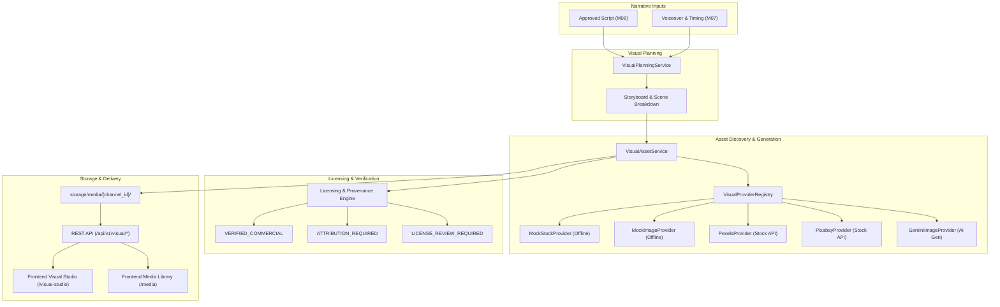

# CREATOR STUDIO AI — M08 VISUAL ASSET ENGINE ARCHITECTURE
## Visual Planning, Asset Discovery & AI Image Generation

**Project Owner:** Muhammad Ali ([alibuild.site](https://alibuild.site))  
**Milestone:** M08 of 15  
**Module:** Visual Planning, Asset Discovery & AI Image Generation  
**Status:** Completed & Verified (116/116 tests passing, 0 TS errors, 0 ESLint warnings, 27 routes compiled)

---

## 1. Subsystem Overview

Milestone 08 bridges narrative audio (Milestones 06 & 07) and video assembly (Milestones 09 & 11) by converting approved video scripts and synthesized voice narration into an ordered, timed visual storyboard populated with verified visual assets.

---

## 2. Core Entities & Data Architecture

### 2.1 Database Models

1. **`Storyboard`** (`storyboards` table)
   - `id`: UUID (PK)
   - `project_id`: UUID (FK -> `video_projects.id`, ON DELETE CASCADE)
   - `script_id`: UUID (FK -> `scripts.id`, ON DELETE SET NULL)
   - `narration_track_id`: UUID (FK -> `narration_tracks.id`, ON DELETE SET NULL)
   - `version`: Integer (default 1)
   - `status`: String (`DRAFT`, `IN_REVIEW`, `APPROVED`)
   - `aspect_ratio`: String (`16:9`, `9:16`)
   - `scene_count`: Integer (default 0)
   - `approved_scene_count`: Integer (default 0)
   - Timestamps & UUID Primary Key

2. **`Scene` Extensions** (`scenes` table)
   - `storyboard_id`: UUID (FK -> `storyboards.id`, ON DELETE CASCADE, nullable)
   - `visual_purpose`: String(64) (`HOOK_ENGAGEMENT`, `CONCEPT_EXPLANATION`, `DEMONSTRATION`, `SUMMARY`)
   - `suggested_asset_type`: String(64) (`SCREENSHOT`, `SOFTWARE_INTERFACE`, `CODE_DEMONSTRATION`, `PRODUCT_IMAGERY`, `ILLUSTRATION`, `DIAGRAM`, `CHART`, `STOCK_FOOTAGE`, `BACKGROUND_VISUAL`, `GENERATED_IMAGE`)
   - `search_keywords`: JSON (List of keyword strings)
   - `image_prompt`: Text (Tailored prompt for generative models)
   - `transition`: String(32) (`CUT`, `FADE`, `ZOOM_IN`, `PAN_RIGHT`, `SLIDE_LEFT`)
   - `review_status`: String(32) (`DRAFT`, `SUGGESTED`, `APPROVED`, `REJECTED`)
   - `selected_asset_id`: UUID (FK -> `media_assets.id`, ON DELETE SET NULL, nullable)

3. **`MediaAsset` Extensions** (`media_assets` table)
   - `channel_id`: UUID (FK -> `channels.id`, ON DELETE CASCADE, index=True)
   - `title`: String(255)
   - `description`: Text (nullable)
   - `source_provider`: String(64) (`MOCK`, `PEXELS`, `PIXABAY`, `UNSPLASH`, `GEMINI_IMAGEN`, `USER_UPLOAD`)
   - `source_url`: Text (nullable)
   - `preview_url`: Text (nullable)
   - `author_name`: String(255) (nullable)
   - `author_url`: Text (nullable)
   - `license_status`: String(64) (`VERIFIED_COMMERCIAL`, `ATTRIBUTION_REQUIRED`, `LICENSE_REVIEW_REQUIRED`, `RESTRICTED`)
   - `attribution_text`: Text (nullable)
   - `aspect_ratio`: String(16) (`16:9`, `9:16`, `1:1`, `CUSTOM`)
   - `width`: Integer (nullable)
   - `height`: Integer (nullable)
   - `mime_type`: String(64) (`image/png`, `image/jpeg`, `image/webp`, `video/mp4`)
   - `duration_seconds`: Numeric(8, 2) (nullable, for video clips)
   - `asset_category`: String(64) (`GENERATED`, `EXTERNAL_STOCK`, `USER_UPLOADED`, `SCREENSHOT`, `DIAGRAM`, `ILLUSTRATION`, `BROLL`)
   - `is_archived`: Boolean (default False)

---

## 3. Provider Abstraction Layer

### 3.1 Common Interfaces (`app.providers.visual.base`)
- `StockAssetResult`: Discovered external stock item (title, preview_url, download_url, source_provider, license_type, author, dimensions).
- `StockSearchProviderInterface`: Contract for querying external media engines (`search(query, aspect_ratio, page, per_page)`).
- `ImageGenerationResult`: Generated image item (image_bytes, format, width, height, aspect_ratio, prompt).
- `ImageGenerationProviderInterface`: Contract for synthesizing original visual assets (`generate_image(prompt, aspect_ratio, style)`).

### 3.2 Implementations
1. **`MockStockProvider`**: 100% offline, deterministic stock search engine returning diverse, categorized tech and business assets with verified CC0 licensing.
2. **`MockImageProvider`**: Pure-Python image generator using standard library or PIL/Pillow to render crisp placeholder PNGs with geometric framing, aspect ratio markers (16:9 or 9:16), scene metadata, and distinct palette colors.
3. **`PexelsProvider`**: Official Pexels REST API client (`https://api.pexels.com/v1/search`), handling rate limits, CC-compatible licensing attribution, and preview URLs (active only when `PEXELS_API_KEY` is present).
4. **`PixabayProvider`**: Official Pixabay REST API client (`https://pixabay.com/api/`), handling queries and free commercial licensing (active only when `PIXABAY_API_KEY` is present).
5. **`GeminiImageProvider`**: Integration with Google GenAI Imagen model family when enabled, strictly respecting the \$0.00 budget ceiling.

---

## 4. Licensing Safeguards & Provenance Engine

1. **Licensing Categories**:
   - `VERIFIED_COMMERCIAL`: Public domain (CC0), Pexels Free License, Pixabay License, or generated content explicitly granted for commercial use.
   - `ATTRIBUTION_REQUIRED`: Permitted for commercial use but requires on-screen or description citation (e.g. CC-BY).
   - `LICENSE_REVIEW_REQUIRED`: Default for unverified external sources, scraping, or ambiguous terms. Triggers warning in UI.
   - `RESTRICTED`: Editorial-only or non-commercial assets; blocked from YouTube upload veto gate.
2. **Provenance Preservation**: Source URL, creator name, original license name, and SHA-256 content hashes are retained permanently on every asset record.

---

## 5. Security & Storage Architecture

1. **Storage Isolation**: Assets stored under `storage/media/{channel_id}/{asset_id}.{ext}`.
2. **Multi-Tenant Partitioning**: All database queries and file retrieval endpoints enforce `channel_id` validation via Supabase Auth JWT.
3. **Magic Byte Content Inspection**: Uploaded assets undergo MIME signature sniffing (PNG `\x89PNG\r\n\x1a\n`, JPEG `\xff\xd8\xff`, WEBP `RIFF....WEBP`, MP4 `ftyp`). File extensions alone are never trusted.
4. **Path Traversal Guards**: Absolute and relative path sanitization blocks traversal outside `storage/media/`.

---

## 6. Durable Worker Queue Handlers

1. `STORYBOARD_GENERATION`: Generates storyboard scenes, visual directives, keywords, and prompts from script and voiceover.
2. `VISUAL_ASSET_SEARCH`: Multi-provider background media search.
3. `IMAGE_GENERATION`: Asynchronous image generation job with backoff and retry management.

---

## 7. REST API Surface (`/api/v1/visual`)

- `POST /api/v1/visual/storyboards/generate`: Generate storyboard for a project.
- `GET /api/v1/visual/storyboards/{project_id}`: Retrieve active storyboard with scenes and assigned assets.
- `PUT /api/v1/visual/storyboards/{storyboard_id}/scenes/{scene_id}`: Update scene visual directive, keywords, prompt, transition.
- `POST /api/v1/visual/storyboards/{storyboard_id}/scenes/{scene_id}/assign-asset`: Assign asset to scene.
- `POST /api/v1/visual/storyboards/{storyboard_id}/scenes/{scene_id}/generate-image`: Synthesize image for scene.
- `POST /api/v1/visual/storyboards/{storyboard_id}/scenes/reorder`: Reorder scene sequence.
- `POST /api/v1/visual/storyboards/{storyboard_id}/approve`: Storyboard approval gate.
- `POST /api/v1/visual/assets/search`: Search external stock assets.
- `POST /api/v1/visual/assets/import-external`: Import external search result into project library.
- `GET /api/v1/visual/assets`: List assets with filtering.
- `POST /api/v1/visual/assets/upload`: Secure multipart file upload.
- `GET /api/v1/visual/assets/{asset_id}`: Get asset details and licensing metadata.
- `PATCH /api/v1/visual/assets/{asset_id}/license`: Update licensing status.
- `DELETE /api/v1/visual/assets/{asset_id}`: Archive/delete asset.
- `GET /api/v1/visual/assets/{asset_id}/file`: Secure streaming binary asset delivery.
