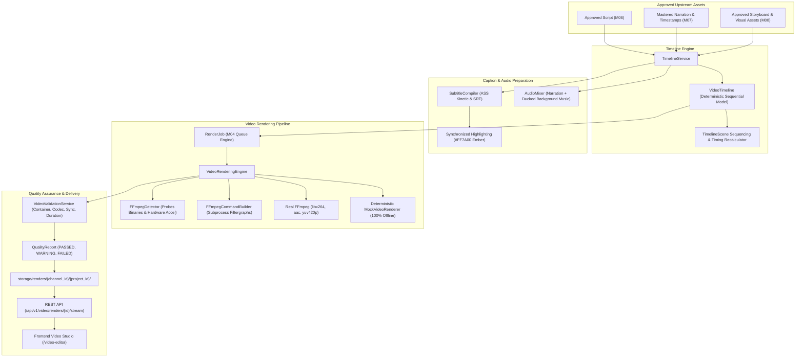

# CREATOR STUDIO AI — M09 VIDEO PRODUCTION & AUTOMATED EDITING ENGINE ARCHITECTURE
## Video Timeline, Assembly, FFmpeg Rendering & Automated QA

**Project Owner:** Muhammad Ali ([alibuild.site](https://alibuild.site))  
**Milestone:** M09 of 15  
**Module:** Video Timeline, Assembly, FFmpeg Rendering & Quality Assurance  
**Status:** In Progress (Design & Implementation)

---

## 1. Subsystem Overview

Milestone 09 converts approved project assets (M06 scripts, M07 mastered narration tracks, M08 visual storyboards and media assets) into finished, broadcast-compliant, downloadable video files (MP4) in both 16:9 Long-Form ($1920\times1080$) and 9:16 Shorts ($1080\times1920$) formats.

---

## 2. Core Entities & Data Architecture

### 2.1 Database Models

1. **`VideoTimeline`** (`video_timelines` table)
   - `id`: UUID (PK)
   - `project_id`: UUID (FK -> `video_projects.id`, ON DELETE CASCADE)
   - `storyboard_id`: UUID (FK -> `storyboards.id`, ON DELETE SET NULL)
   - `script_id`: UUID (FK -> `scripts.id`, ON DELETE SET NULL)
   - `narration_track_id`: UUID (FK -> `narration_tracks.id`, ON DELETE SET NULL)
   - `version`: Integer (default 1)
   - `title`: String(255)
   - `format`: String(32) (`LONG_FORM`, `SHORTS`)
   - `aspect_ratio`: String(16) (`16:9`, `9:16`)
   - `resolution`: String(32) (`1080p`, `720p`)
   - `fps`: Integer (default 30)
   - `total_duration_seconds`: Numeric(8, 2)
   - `status`: String(32) (`DRAFT`, `VALIDATED`, `RENDERING`, `RENDERED`, `FAILED`)
   - `music_asset_id`: UUID (FK -> `media_assets.id`, ON DELETE SET NULL, nullable)
   - `music_volume`: Numeric(4, 2) (default 0.15)
   - `enable_captions`: Boolean (default True)
   - `caption_style`: String(32) (default "EMBER_KINETIC")
   - `settings`: JSON (render parameters, transition duration, motion speed)

2. **`TimelineScene`** (`timeline_scenes` table)
   - `id`: UUID (PK)
   - `timeline_id`: UUID (FK -> `video_timelines.id`, ON DELETE CASCADE)
   - `scene_id`: UUID (FK -> `scenes.id`, ON DELETE SET NULL, nullable)
   - `scene_order`: Integer
   - `start_time_seconds`: Numeric(8, 3)
   - `end_time_seconds`: Numeric(8, 3)
   - `duration_seconds`: Numeric(8, 3)
   - `media_asset_id`: UUID (FK -> `media_assets.id`, ON DELETE SET NULL, nullable)
   - `voiceover_id`: UUID (FK -> `voiceovers.id`, ON DELETE SET NULL, nullable)
   - `narration_text`: Text
   - `transition_type`: String(32) (`CUT`, `FADE`, `CROSSFADE`)
   - `transition_duration_seconds`: Numeric(4, 2) (default 0.50)
   - `motion_effect`: String(32) (`NONE`, `SLOW_ZOOM_IN`, `SLOW_ZOOM_OUT`, `PAN_LEFT`, `PAN_RIGHT`)
   - `fit_mode`: String(32) (`COVER`, `CONTAIN`, `CROP`)
   - `status`: String(32) (`READY`, `MISSING_ASSET`, `NEEDS_REVIEW`)

3. **`CaptionAsset`** (`caption_assets` table)
   - `id`: UUID (PK)
   - `timeline_id`: UUID (FK -> `video_timelines.id`, ON DELETE CASCADE)
   - `format`: String(16) (`SRT`, `ASS`, `VTT`)
   - `storage_path`: Text
   - `cue_count`: Integer
   - `duration_seconds`: Numeric(8, 3)
   - `sha256_hash`: String(64)

4. **`RenderJob` Extensions** (`render_jobs` table)
   - `timeline_id`: UUID (FK -> `video_timelines.id`, ON DELETE SET NULL, nullable, index=True)
   - `current_stage`: String(64) (`INITIALIZING`, `VALIDATING_INPUTS`, `BUILDING_TIMELINE`, `PREPARING_AUDIO_AND_CAPTIONS`, `RENDERING_SCENES`, `ENCODING_MASTER_MP4`, `VALIDATING_OUTPUT`, `COMPLETED`, `FAILED`)
   - `progress_percentage`: Integer (default 0)
   - `output_format`: String(32) (default "mp4")
   - `file_size_bytes`: BigInteger (default 0)
   - `sha256_hash`: String(64) (default "")
   - `video_width`: Integer (default 1920)
   - `video_height`: Integer (default 1080)
   - `fps`: Integer (default 30)
   - `quality_status`: String(32) (`PENDING`, `PASSED`, `WARNING`, `FAILED`)
   - `log_tail`: Text

---

## 3. Kinetic Typography Subtitles (`SubtitleCompiler`)

- **Format:** Advanced SubStation Alpha (`.ass` v4.00+) and SubRip (`.srt`).
- **Styling Tokens:**
  - Font: Segoe UI, Roboto, or Arial Bold.
  - Primary color: White (`&H00FFFFFF&`).
  - Outline color: Obsidian `#090A0D` (`&H000D0A09&`), 3px stroke.
  - Active-word highlight: Vivid Ember `#FF7A00` (`&H00007AFF&`), karaoke tag `{\k...}`.
  - Alignment: Centered bottom for 16:9 (`Alignment 2`, margin 40px); Centered middle/lower-third for 9:16 Shorts (`Alignment 2`, margin 120px above UI elements).

---

## 4. Multi-Track Audio Mixing & Ducking

- Master speech vocals from Milestone 07 are the dominant, protected audio channel.
- When optional user background music is configured:
  - Default volume: 15% ($-16\text{ dBFS}$).
  - Automatic ducking: fades music down 6dB during spoken phrases and fades back during scene transition pauses.
  - EBU R128 loudness check ensures combined output remains $-14.0\text{ LUFS} \pm 1.5\text{ LUFS}$ with peak ceiling $\le -1.0\text{ dBTP}$.

---

## 5. Dual-Mode Rendering Architecture

1. **Host-Native FFmpeg Engine**:
   - Detects `ffmpeg` and `ffprobe` binaries across PATH and standard install directories.
   - Executes non-shell subprocess arguments with stdout/stderr pipes, timeout guards, and real-time stderr progress parsing (`time=HH:MM:SS.ms`).
   - Uses standard H.264 profile: `-c:v libx264 -pix_fmt yuv420p -profile:v high -level 4.1 -preset medium -crf 20 -c:a aac -b:a 192k -ar 48000 -movflags +faststart`.
2. **Deterministic Mock Video Renderer (`MockVideoRenderer`)**:
   - 100% offline, pure-Python / Pillow / standard library container engine.
   - Generates valid, standards-compliant MP4 test video containers with embedded audio tracks and metadata for automated CI/CD and offline workstation development.

---

## 6. Deterministic Output Quality Assurance Gate

Before a render is marked `COMPLETED`:
- File exists on disk and is non-empty.
- Container header verifies valid MP4 box signature (`ftyp`).
- Dimensions exactly match target profile ($1920\times1080$ or $1080\times1920$).
- Video duration matches narration track within tolerance ($\pm 2.0\text{s}$).
- Audio stream is present and non-silent.
- Records QA diagnostics in `quality_reports`.
