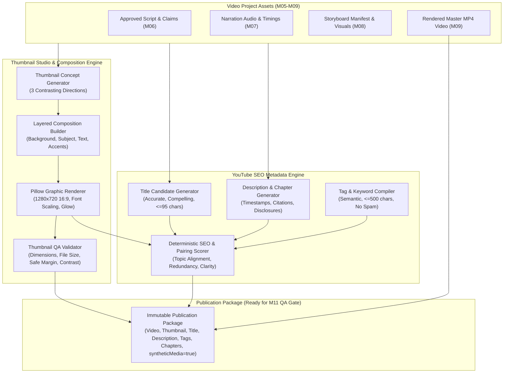

# M10 — AI Thumbnail Composition & YouTube SEO Metadata Engine
## Technical Specification and Architecture Blueprint

**Project:** Creator Studio AI  
**Owner:** Muhammad Ali ([alibuild.site](https://alibuild.site))  
**Milestone:** M10 of 15  
**Status:** In Development  

---

## 1. Subsystem Mission & Scope

Milestone 10 builds two tightly coupled creative and optimization engines that prepare a finished video for pre-publish quality assurance (M11) and YouTube publishing (M12):

1. **Thumbnail Studio & Composition Engine:**
   - Multi-layer procedural composition architecture rendering exact $1280\times720$ (16:9) graphic assets under $2.0\text{ MB}$.
   - Layer model: Background (solid/gradient/generative/imported), Visual Subject/Focal Element, Text Elements (Headline, Sub-headline, Badge hook), Decorative/Accent Graphics (glows, borders, dark vignettes, badges).
   - Reusable Design Presets:
     - `modern_tech_editorial` (Clean typography, gradient backdrop, crisp code/isometric badge)
     - `minimalist_professional` (High negative space, high contrast, single sharp focal element)
     - `high_contrast_educational` (Bold yellow/ember headlines, dark obsidian background, clear comparison)
     - `bold_creator` (Punchy 2-4 word hook, neon borders, expressive glow)
     - `software_tutorial` (IDE code snippet, dark frame, prominent technology brand badge)
     - `cinematic_tech` (Deep dark lighting, subtle ember edge-lighting, cinematic typography)
   - Editable composition data model with full versioning and draft storage.
   - Separation of visual image generation (AI background/subject via M08 provider layer) and typography rendering (Pillow rasterization with automatic font scaling, shadows, and contrast borders to eliminate AI spelling artifacts).
   - Deterministic thumbnail quality validation gate (`PASSED`, `WARNING`, `FAILED`, `NEEDS_REVIEW`).

2. **YouTube SEO Metadata Engine:**
   - Structured metadata generation driven by actual video content, approved scripts (M06), and verified research sources (M05).
   - Multi-candidate title generator strictly enforcing honesty (no deceptive clickbait) and YouTube title constraints ($\le 95$ chars).
   - Structured description generator: hook summary, core narrative, key takeaways, verified research citations, chapter timestamps (aligned with M07 voiceover and M09 video timeline), hashtags ($\le 5$), channel links, and mandatory synthetic media disclosure (`syntheticMedia: true`).
   - Relevant search tags generator complying with YouTube's 500-character ceiling, free from keyword stuffing.
   - Narrative chapter breakdown aligned with video timeline markers ($t=00:00$ start, strictly sequential).
   - Pinned comment generator providing conversational prompts to spark authentic community engagement.
   - Deterministic SEO quality and clarity scorer ($0-100$).
   - Thumbnail + Title pairing consistency evaluator.

3. **Publication Package Assembler:**
   - Aggregates the finished video render (M09), approved thumbnail, approved title, description, tags, hashtags, chapters, and synthetic content flag into an immutable publication package ready for M11 QA veto audit.

---

## 2. Architecture & Data Flow

---

## 3. Database Schema Design

### A. Model: `Thumbnail` (`thumbnails` table enhancements)
Existing columns: `id`, `project_id`, `variant_code`, `storage_path`, `headline_text`, `accent_color_hex`, `is_selected`, `created_at`, `updated_at`.
New columns added in M10:
- `composition_data`: `JSON` (ordered layers, positions, fonts, colors, effects)
- `concept_data`: `JSON` (design direction, visual prompt, rationale)
- `style_preset`: `String(64)` default "modern_tech_editorial"
- `width`: `Integer` default 1280
- `height`: `Integer` default 720
- `file_size_bytes`: `BigInteger` default 0
- `format`: `String(16)` default "PNG"
- `quality_status`: `String(32)` default "PENDING" (`PASSED`, `WARNING`, `FAILED`, `NEEDS_REVIEW`)
- `quality_report`: `JSON` (contrast score, safe margin check, dimension verification)
- `version`: `Integer` default 1

### B. Model: `VideoMetadataDraft` (`video_metadata_drafts` table)
- `id`: UUID PK
- `project_id`: UUID FK -> `video_projects.id` ON DELETE CASCADE
- `title`: `String(255)` NOT NULL
- `description`: `Text` NOT NULL
- `tags`: `JSON` (list of strings) NOT NULL
- `hashtags`: `JSON` (list of strings) NOT NULL
- `chapters`: `JSON` (list of `{ "timestamp": "00:00", "seconds": 0.0, "title": str }`) NOT NULL
- `pinned_comment`: `Text` NULL
- `synthetic_media_disclosure`: `Boolean` default True NOT NULL
- `seo_score`: `Float` default 0.0 NOT NULL
- `seo_report`: `JSON` NOT NULL
- `version`: `Integer` default 1 NOT NULL
- `is_approved`: `Boolean` default False NOT NULL
- `created_at`, `updated_at`: DateTime

### C. Model: `PublicationPackage` (`publication_packages` table)
- `id`: UUID PK
- `project_id`: UUID FK -> `video_projects.id` ON DELETE CASCADE
- `render_job_id`: UUID FK -> `render_jobs.id` ON DELETE SET NULL
- `thumbnail_id`: UUID FK -> `thumbnails.id` ON DELETE SET NULL
- `metadata_id`: UUID FK -> `video_metadata_drafts.id` ON DELETE SET NULL
- `status`: `String(32)` default "DRAFT" (`DRAFT`, `READY_FOR_QA`, `APPROVED`)
- `package_manifest`: `JSON` NOT NULL
- `created_at`, `updated_at`: DateTime

---

## 4. API Endpoints Surface (`/api/v1/*`)

### Thumbnail Studio
- `POST /api/v1/thumbnails/concepts`: Generate 3 contrasting thumbnail concepts from project script & visuals.
- `POST /api/v1/thumbnails/compose`: Render composite thumbnail image using Pillow from layer specifications.
- `GET /api/v1/thumbnails/projects/{project_id}`: Retrieve all thumbnail variants and compositions for a project.
- `GET /api/v1/thumbnails/{thumbnail_id}`: Get thumbnail details and layer hierarchy.
- `PATCH /api/v1/thumbnails/{thumbnail_id}`: Update composition layers, headline, typography, and re-render.
- `POST /api/v1/thumbnails/{thumbnail_id}/select`: Mark variant as the project's selected thumbnail.
- `GET /api/v1/thumbnails/{thumbnail_id}/file`: Authenticated streaming endpoint for thumbnail image PNG/JPEG.
- `POST /api/v1/thumbnails/{thumbnail_id}/validate`: Deterministically validate thumbnail dimensions, size, and readability.

### SEO Metadata Studio
- `POST /api/v1/metadata/generate`: Generate title candidates, description, tags, hashtags, chapters, and pinned comment.
- `GET /api/v1/metadata/projects/{project_id}`: Retrieve metadata drafts for project.
- `PATCH /api/v1/metadata/{metadata_id}`: Edit titles, description sections, tags, or chapter markers.
- `POST /api/v1/metadata/{metadata_id}/evaluate`: Run deterministic SEO evaluation & thumbnail/title pairing score.
- `POST /api/v1/metadata/{metadata_id}/approve`: Approve metadata draft.

### Publication Package
- `POST /api/v1/publication-packages`: Assemble publication package linking video render, thumbnail, and metadata.
- `GET /api/v1/publication-packages/projects/{project_id}`: Retrieve publication package for project.
- `POST /api/v1/publication-packages/{package_id}/approve`: Approve publication package for M11 QA gate.

---

## 5. Zero-Cost Budget & Deterministic Testing Policy
- Default paid API budget is `$0.00`.
- All automated unit, component, and integration tests use local Pillow image rendering and offline mock AI providers (`MockAIProvider`, `MockStockProvider`, `MockImageProvider`).
- No paid API calls or cloud credentials are required to build, test, or verify the complete subsystem.
