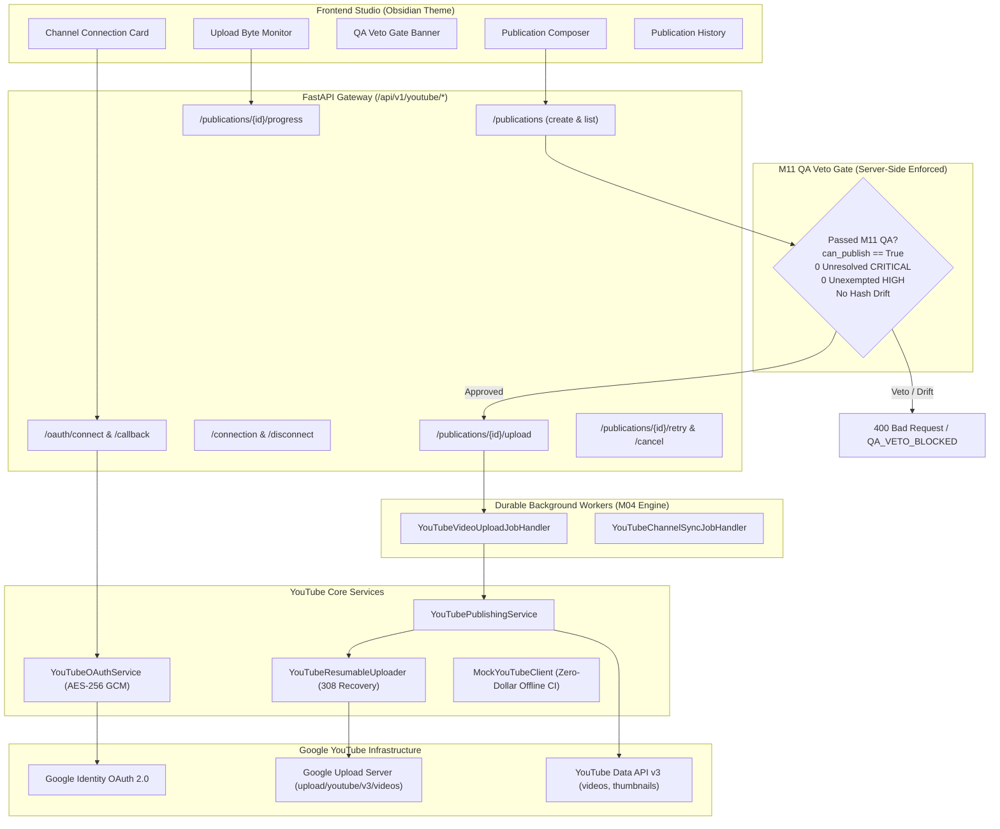

# Milestone 12 — YouTube OAuth 2.0 & Resumable Publishing Architecture
## Creator Studio AI: Enterprise YouTube Integration Subsystem

**Project Owner:** Muhammad Ali ([alibuild.site](https://alibuild.site))  
**Milestone:** M12 of 15  
**Subsystem:** YouTube OAuth 2.0, Resumable Upload Protocol, Scheduled Publishing & M11 QA Veto Gate Enforcement

---

## 1. Architectural Overview

The Creator Studio AI Publishing Engine bridges the finalized video generation pipeline (M06 Scripts, M07 Voiceover, M08 Visuals, M09 Video Rendering, M10 Thumbnails & SEO, M11 QA Veto Gate) with Google's YouTube Data API v3 and Google Resumable Media Upload Protocol.



---

## 2. YouTube OAuth 2.0 Flow & State Security

1. **Authorization URL Generation (`GET /api/v1/youtube/connect`):**
   - Generates cryptographically secure, signed CSRF state tokens containing tenant ID, timestamp, and random entropy.
   - Directs the channel owner to Google's consent screen requesting least-privilege scopes:
     - `https://www.googleapis.com/auth/youtube.upload` (Upload and manage video metadata).
     - `https://www.googleapis.com/auth/youtube.readonly` (Inspect channel statistics and verify uploads).
   - Enforces `access_type=offline` and `prompt=consent` to guarantee issuance of a durable `refresh_token`.

2. **Authorization Code Exchange (`GET /api/v1/youtube/oauth/callback`):**
   - Validates CSRF state parameter and ensures expiration window has not lapsed.
   - Exchanges authorization code for access token and refresh token via Google OAuth 2.0 token endpoint.
   - Retrieves YouTube channel profile (`channels.list?mine=true&part=snippet,statistics`):
     - `channel_id`, `title`, `description`, `custom_url`, `thumbnail_url`, `subscriber_count`.
   - Encrypts refresh token using AES-256-GCM before writing to the database.
   - Redacts all secrets and refresh tokens from HTTP response schemas and application logs.

3. **Safe Disconnect (`POST /api/v1/youtube/disconnect`):**
   - Revokes OAuth token with Google OAuth endpoints.
   - Overwrites and clears encrypted refresh token from database.
   - Marks channel as inactive or clears connected credentials.

---

## 3. Mandatory Server-Side M11 QA Veto Gate Enforcement

No video can be scheduled, uploaded, or queued for YouTube without passing strict server-side validation against Milestone 11 QA audit records:

1. **Veto Decision Check:**
   - Publication package must reference an executed `QARun`.
   - `QARun.veto_decision` MUST be either `APPROVED` or `READY_FOR_APPROVAL`.
   - `QARun.can_publish` MUST equal `True`.

2. **Zero Unresolved Critical / High Findings:**
   - `QARun` must have **0** unresolved findings with `CRITICAL` severity (critical findings can never be waived).
   - `QARun` must have **0** unresolved `HIGH` severity findings without an active, unexpired `QAException` authorized by an `ADMIN` or `SUPER_ADMIN`.

3. **Artifact Snapshot Integrity & Anti-Drift Verification:**
   - The SHA-256 hashes of the video render, narration audio, visual storyboard, and thumbnail must match the exact snapshot captured during the QA run.
   - If any asset was replaced or modified post-approval, the gate vetoes publication with error code `QA_HASH_DRIFT_DETECTED` and requires a new QA audit pass.

---

## 4. Google Resumable Upload Protocol & Interruption Recovery

Large video uploads are prone to socket drops, worker restarts, rate limits, and network timeouts. The system implements the full Google Resumable Media Protocol:

1. **Initiation (`POST /upload/youtube/v3/videos?uploadType=resumable&part=snippet,status`):**
   - Sends initial JSON payload: `title`, `description`, `tags`, `categoryId: "28"`, `status: {privacyStatus, publishAt, selfDeclaredMadeForKids: false, containsSyntheticMedia: true}`.
   - Includes headers:
     - `X-Upload-Content-Type: video/mp4`
     - `X-Upload-Content-Length: <total_file_size_bytes>`
   - Google responds with HTTP 200/201 and a unique `Location` header containing the resumable session URI.
   - The session URI is encrypted at rest and recorded in `YouTubeUploadSession`.

2. **Chunked Streaming (`PUT <session_uri>`):**
   - Configurable chunk size (multiples of 256 KiB; default 8 MiB or 16 MiB).
   - Header: `Content-Range: bytes <start>-<end>/<total_bytes>`.
   - Intermediate chunk response: **HTTP 308 Resume Incomplete** with header `Range: bytes=0-<last_byte>`.
   - Final chunk response: **HTTP 200 / 201 Created** containing the final `video_id`.

3. **Network Failure & Worker Crash Recovery:**
   - Upon connection drop or worker restart, the worker queries Google for upload status:
     - `PUT <session_uri>` with `Content-Range: bytes */<total_bytes>`.
   - Google returns **HTTP 308** with `Range: bytes=0-<last_received_byte>`.
   - The worker parses the byte offset and seamlessly resumes uploading from byte `<last_received_byte + 1>`.
   - Exponential backoff with jitter and honors `Retry-After` headers on 5xx server errors or 429 rate limits.

4. **Thumbnail Attachment (`POST /upload/youtube/v3/thumbnails/set?videoId=<id>`):**
   - Once video is uploaded, the generated 1280x720 JPEG thumbnail is dispatched directly to the YouTube Thumbnail API.

---

## 5. Resumable Upload State Machine

```
[DRAFT] 
   │
   ▼ (User or cron triggers publish)
[QUEUED] ── (M11 QA check fails) ──► [FAILED (QA_VETO_BLOCKED)]
   │
   ▼ (Worker claims job & initiates session)
[UPLOADING] ◄──┐ (Resumes next chunk)
   │           │
   ├─► (Network drop / 5xx) ──► [RECOVERING] ──► (Query 308 Range) ──┘
   │
   ▼ (Final chunk 200/201 Created)
[PROCESSING] (Attaching custom thumbnail & setting scheduled publish)
   │
   ├─► (If scheduled publish_at is set) ──► [SCHEDULED]
   │
   ▼ (If instant publish / unlisted)
[PUBLISHED]
```

---

## 6. Zero-Dollar Offline Testing Strategy

To guarantee rapid, zero-cost CI/CD and offline verification without requiring active Google API quotas:
- `MockYouTubeClient` implements the identical interface as the real Google client:
  - Generates mock OAuth consent URLs and state tokens.
  - Exchanges mock auth codes for simulated tokens.
  - Simulates resumable chunk uploads, returns HTTP 308 with incremental ranges, handles status queries (`bytes */N`), and yields synthetic YouTube video IDs (`yt_mock_...`).
  - Supports simulated faults (network disconnect after chunk 1, expired tokens, rate limit backoff).
