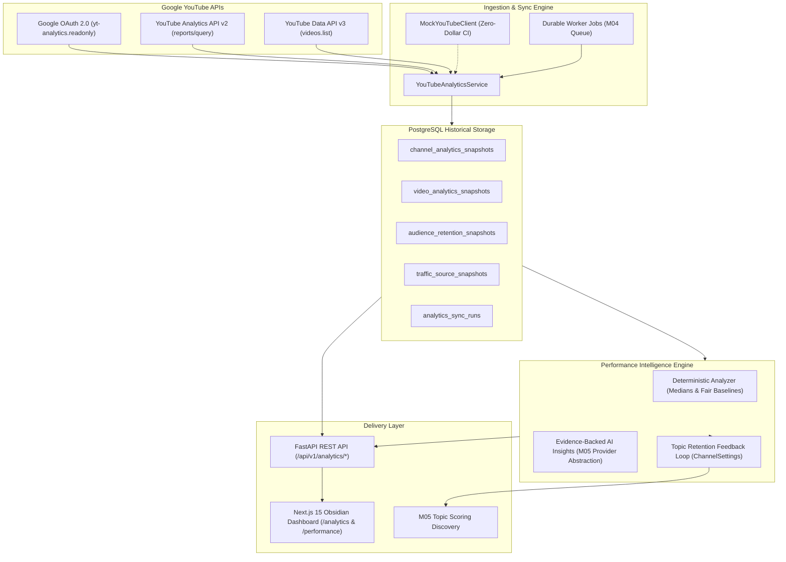

# Milestone 13: YouTube Analytics & Performance Intelligence Architecture

**Creator Studio AI**  
**Project Owner:** Muhammad Ali ([alibuild.site](https://alibuild.site))  
**Module:** YouTube Analytics, Historical Snapshot Engine & Performance Intelligence  
**Document Status:** Approved Architecture  

---

## 1. System Overview

Milestone 13 introduces an authoritative, production-grade YouTube Analytics and Performance Intelligence subsystem for Creator Studio AI. The system ingests channel and video performance metrics via official Google APIs, stores persistent historical snapshots, computes deterministic performance indicators, generates evidence-backed insights, adjusts topic opportunity scoring weights through an automated feedback loop, and surfaces telemetry through an Obsidian dark analytics studio.

---

## 2. Official Google APIs & OAuth 2.0 Integration

### 2.1 Authorized Scopes
1. `https://www.googleapis.com/auth/youtube.upload` (M12 — Video uploads)
2. `https://www.googleapis.com/auth/youtube.readonly` (M12 & M13 — Channel metadata, video stats)
3. `https://www.googleapis.com/auth/yt-analytics.readonly` (M13 — Channel and video performance reports)

### 2.2 Endpoint Specifications
- **YouTube Analytics Reporting API:** `https://youtubeanalytics.googleapis.com/v2/reports`
  - Query parameters: `ids=channel==MINE`, `startDate=YYYY-MM-DD`, `endDate=YYYY-MM-DD`, `metrics=...`, `dimensions=...`, `filters=...`, `sort=...`
- **YouTube Data API v3:** `https://www.googleapis.com/youtube/v3/videos?part=contentDetails,statistics,snippet`
  - Used for authoritative duration parsing, published date validation, and metadata alignment.

### 2.3 Incremental Authorization & Safe Fallback
If an existing channel connection has not yet granted `yt-analytics.readonly`, the system displays a clear authorization upgrade prompt rather than fabricating statistics.

---

## 3. Historical Snapshot & Data Models

### 3.1 `channel_analytics_snapshots`
Daily aggregate telemetry across the entire channel:
- `snapshot_date`: Target UTC date.
- `views`: Total channel views.
- `watch_time_minutes`: Total estimated watch time in minutes.
- `average_view_duration_seconds`: Weighted average duration.
- `average_view_percentage`: Average percentage watched.
- `subscribers_gained`: Gained subscriber count.
- `subscribers_lost`: Lost subscriber count.
- `net_subscribers`: `subscribers_gained - subscribers_lost`.
- `likes`, `comments`, `shares`.
- `impressions`: Total thumbnail impressions.
- `click_through_rate`: Ratio of views to impressions ($0.0000 - 1.0000$).
- `freshness_status`: `FRESH`, `DELAYED`, `STALE`, `PROVISIONAL`.
- `data_completeness`: Whether YouTube has finalized 48h retrospective auditing.

### 3.2 `video_analytics_snapshots`
Per-video periodic performance metrics:
- `youtube_video_id`: YouTube video identifier.
- `snapshot_date`: Target UTC date.
- `views`, `watch_time_minutes`, `average_view_duration_seconds`, `average_view_percentage`.
- `likes`, `comments`, `shares`, `subscribers_gained`, `subscribers_lost`.
- `impressions`, `click_through_rate`.
- `retention_at_30s`: Crucial hook benchmark ($0.0000 - 1.0000$).
- `content_type`: `LONG_FORM`, `SHORTS`, or `UNKNOWN`.
- `freshness_status`: Data freshness indicator.

### 3.3 `audience_retention_snapshots`
Detailed second-by-second or ratio-based retention curve points:
- `youtube_video_id`: Associated video.
- `relative_retention_points`: JSON array `[{"ratio": 0.05, "watch_percentage": 0.88}, ...]`.
- `drop_off_points`: JSON array of identified steepest drop-off points.
- `retention_at_30s`: Hook retention rate.

### 3.4 `traffic_source_snapshots`
Distribution of discovery mechanisms:
- `traffic_source_type`: `SEARCH`, `SUGGESTED`, `BROWSE`, `EXTERNAL`, `DIRECT`, `PLAYLIST`, `OTHER`.
- `views`, `estimated_minutes_watched`, `percentage`.

### 3.5 `performance_insights` & `performance_recommendations`
Actionable intelligence items with confidence scores, evidence records, and lifecycle statuses (`NEW`, `ACCEPTED`, `REJECTED`, `COMPLETED`, `ARCHIVED`).

---

## 4. Performance Intelligence & Feedback Loop

### 4.1 Deterministic Comparative Engine
To prevent misleading analytics, the engine compares videos fairly:
1. **Age-Matched Cohort Benchmarking:** A video published 24 hours ago is evaluated against 24-hour historical medians, never against 6-month-old accumulated totals.
2. **Format Separation:** Long-form videos (16:9, >60s) and YouTube Shorts (9:16, <=60s) are analyzed in separate cohorts.
3. **Median-Based Baseline:** Channel medians are used instead of averages to resist skew from outlier viral videos.

### 4.2 Algorithmic Topic Retention Feedback Loop
The feedback loop adjusts `ChannelSettings.topic_retention_weights` based on verified viewer retention:
$$\text{Retention Ratio} = \frac{\text{Topic Median 30s Retention}}{\text{Channel Overall Median 30s Retention}}$$
Topics with $\text{Ratio} > 1.15$ receive an upward score multiplier in M05 topic discovery, while chronically under-retaining topics ($\text{Ratio} < 0.80$) are down-weighted.

### 4.3 Evidence-Backed AI Explanations
When enabled, the M05 Gemini provider receives strictly validated metrics to summarize patterns:
- Forbidden from inventing metrics or guessing unrecorded numbers.
- Explicitly distinguishes correlation from causation (e.g., "observed association, not proof of causality").
- Degrades gracefully to 100% deterministic analysis when AI budget is $0.00 or provider is unconfigured.
