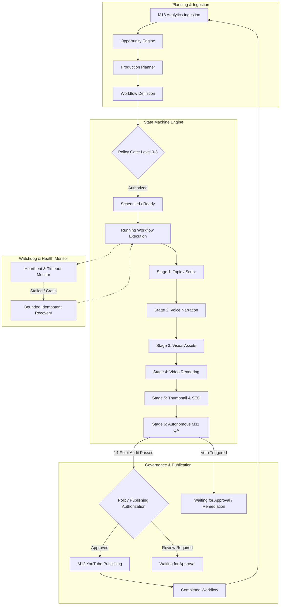
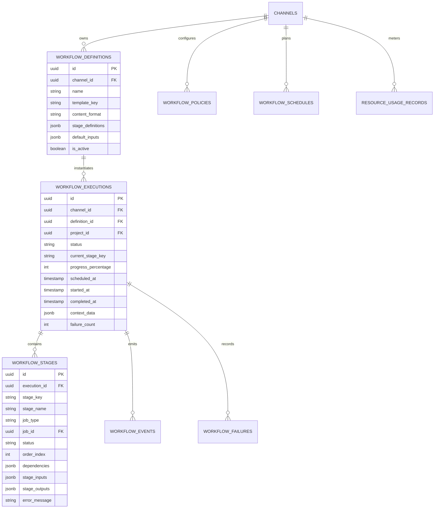

# Creator Studio AI — Milestone 14: Autonomous Orchestration Architecture
## Production Workflow Orchestration, State Machine & Failure Recovery

**Project Owner:** Muhammad Ali  
**Portfolio:** [alibuild.site](https://alibuild.site)  
**System:** Creator Studio AI  
**Milestone:** M14 of 15  
**Document Status:** Production Reference  

---

## 1. Architectural Mission & Philosophy

Milestone 14 introduces a centralized, state-machine driven **Autonomous Orchestration Layer** that coordinates the 9 modular production and intelligence milestones built in M01 through M13:

$$\text{M05 Topic} \longrightarrow \text{M06 Script} \longrightarrow \text{M07 Voice} \longrightarrow \text{M08 Visuals} \longrightarrow \text{M09 Video} \longrightarrow \text{M10 SEO} \longrightarrow \text{M11 QA} \longrightarrow \text{M12 Publish} \longleftrightarrow \text{M13 Analytics}$$

### Core Operating Principle
> **"Automate the workflow, not accountability."**

The orchestration engine determines:
1. **What** should happen (which production stage is next based on template dependencies).
2. **When** it should happen (calendar schedule, queue priority, resource availability).
3. **Which service** executes it (dispatching to existing M04 background worker handlers).
4. **Whether** it is authorized (evaluating channel automation policies and budget limits).
5. **How** progress and health are monitored (heartbeats, stall detection, watchdog).
6. **When** human approval is mandatory (M11 QA gate, YouTube publishing, budget limits).

---

## 2. Workflow State Machine Specification

Every workflow execution transitions through a strictly validated state graph enforced server-side. Direct status mutation via client request is forbidden; all transitions must adhere to valid preconditions.

### 2.1 State Matrix

| State | Description | Permitted Next States |
| :--- | :--- | :--- |
| **DRAFT** | Workflow defined with inputs and stages, but not queued. | `SCHEDULED`, `READY`, `CANCELLED` |
| **SCHEDULED** | Bound to a future execution timestamp in the Production Calendar. | `READY`, `PAUSED`, `CANCELLED` |
| **READY** | Prerequisites and budget verified; eligible for immediate queue dispatch. | `RUNNING`, `PAUSED`, `CANCELLED` |
| **RUNNING** | Actively executing production stages via M04 durable worker queue. | `PAUSED`, `WAITING_FOR_APPROVAL`, `RECOVERING`, `COMPLETED`, `FAILED`, `CANCELLED` |
| **PAUSED** | Temporarily suspended by channel owner or resource throttle. | `RUNNING`, `CANCELLED` |
| **WAITING_FOR_APPROVAL** | Halted at an explicit human checkpoint (Topic, Script, M11 QA, or Publish). | `RUNNING`, `CANCELLED`, `FAILED` |
| **RECOVERING** | Recovering from transient worker crash or timeout using idempotent replay. | `RUNNING`, `FAILED`, `PAUSED` |
| **COMPLETED** | Terminal state: all pipeline stages completed and verified. | *(None)* |
| **FAILED** | Terminal state: unrecoverable error, exhausted retries, or policy rejection. | `READY` *(via explicit manual reset)* |
| **CANCELLED** | Terminal state: aborted by channel owner; ongoing worker tasks revoked. | *(None)* |

---

## 3. Storage & Integration Infrastructure

### 3.1 Zero Additional Infrastructure Commitment
The orchestration system runs entirely on top of the established **M04 PostgreSQL durable queue** (`automation_jobs`). No external message broker (such as Redis, RabbitMQ, or Celery) is introduced, preserving zero-cost developer simplicity and ACID transactional safety.

### 3.2 Database Entity Schema

---

## 4. Failure Recovery & Watchdog Engine

The `ProductionHealthMonitor` and `WorkflowEngine` combine to provide automatic, bounded recovery:

1. **Watchdog Heartbeat Sweeper:** Periodically inspects `running` executions and active stages. If a background job's `heartbeat_at` has lapsed for $> 120\text{s}$ without progress, it is flagged as `STALLED`.
2. **Bounded Replay Limits:** Transient failures are eligible for auto-recovery up to `max_retries` (default: 3). Once retries are exhausted, the execution transitions to `FAILED` with an alert logged to `WorkflowFailure`.
3. **Idempotent Chunking:** Re-running a stage preserves completed upstream artifacts (e.g., if video rendering fails, the approved script and voice track are reused without re-incurring TTS costs).
4. **Publishing Safeguard:** Ambiguous publication status never auto-retries blindly. If an upload state cannot be verified against YouTube Data API, the workflow halts in `WAITING_FOR_APPROVAL` for manual confirmation.
