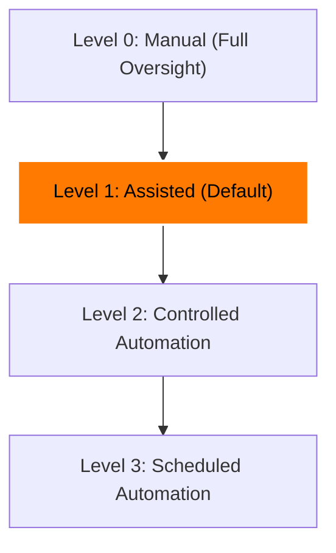

# Creator Studio AI — Milestone 14: Automation Policies & Governance
## Automation Levels, Spending Ceilings & Execution Boundaries

**Project Owner:** Muhammad Ali  
**Portfolio:** [alibuild.site](https://alibuild.site)  
**System:** Creator Studio AI  
**Milestone:** M14 of 15  
**Document Status:** Production Reference  

---

## 1. Automation Tiers (Levels 0–3)

Creator Studio AI implements 4 discrete automation levels to give the channel owner fine-grained control over autonomous pipeline behavior:

### Level 0 — Manual Mode
- **Behavior:** AI generates opportunities and production plans on demand.
- **Execution:** Zero stages run automatically. Every stage initiation requires an explicit user button click or API call.
- **Use Case:** Initial onboarding, debugging new formats, or experimental video styles.

### Level 1 — Assisted Mode (Default System Setting)
- **Behavior:** The system generates weekly production plans and enqueues workflow jobs upon user approval.
- **Execution:** Once a workflow is started, non-checkpoint stages execute automatically. Execution halts at defined approval checkpoints:
  - Topic Selection Approval
  - Script & Storyboard Approval
  - Final QA Veto Gate Approval
  - YouTube Publishing Authorization
- **Use Case:** Standard production environment balancing high throughput with full creator quality assurance.

### Level 2 — Controlled Automation
- **Behavior:** Production runs autonomously from Topic Selection through to Final Render, SEO, and QA Audit.
- **Execution:** Halts *only* if:
  1. M11 QA triggers a critical veto (e.g. low resolution, copyright claim, factual inaccuracy).
  2. Publishing authorization policy requires human confirmation before live YouTube upload.
- **Use Case:** High-volume channels with proven visual/script presets and automated QA confidence.

### Level 3 — Scheduled Automation
- **Behavior:** Complete end-to-end hands-off operation according to the channel's production calendar cadence (e.g., 2 Long-Form, 3 Shorts per week).
- **Execution:** Generates plans, produces assets, audits via M11 QA gate, and publishes to YouTube *only if* an explicit, valid publishing authorization policy is configured.
- **Mandatory Safety Rule:** If M11 QA gate score is $< 80$ or any veto is flagged, autonomous publishing is blocked immediately.

---

## 2. Hard Execution Boundaries & Non-Bypassable Gates

Regardless of the selected automation level (even Level 3), the following security and governance rules are hardcoded and non-bypassable:

1. **Mandatory M11 QA Gate:** Neither automation policies nor AI prompts can bypass the 14-point QA evaluation. Any attempt to upload without an approved `QualityAudit` record results in an immediate HTTP 403 Forbidden.
2. **Mandatory M12 YouTube Authorization:** Publishing requires valid OAuth 2.0 refresh tokens stored with AES-256 encryption. If tokens are expired or disconnected, the workflow safely pauses.
3. **Prompt Injection Defense:** AI-generated text is untrusted. AI output cannot:
   - Alter channel automation levels or permission flags.
   - Expand spending or resource ceilings.
   - Self-approve failed QA checks.
   - Trigger YouTube publishing directly.
4. **Zero-Dollar Budget Governor:** Default budget is strictly $0.00. Workflows attempting to make billable external API calls without an explicitly configured non-zero budget ceiling are blocked.
5. **Multi-Tenant Channel Isolation:** All policies, workflows, schedules, and usage records are strictly bound to `channel_id` and verified against the authenticated user's channel membership.

---

## 3. Resource & Concurrency Governance

The `ResourceGovernor` enforces strict resource bounds:

- **Maximum Concurrent Workflows:** Default 2 per channel (prevents worker queue starvation and FFmpeg CPU saturation).
- **Maximum Weekly Productions:** Configurable (e.g. 2 Long-form + 3 Shorts).
- **Storage Allocation Ceiling:** Configurable local disk cap (default 20 GB). Workflows halt before rendering if remaining disk space is insufficient.
- **Timezone-Aware Scheduling Windows:** Configurable allowed execution hours (e.g. 02:00–06:00 UTC) to minimize peak-hour system load.
