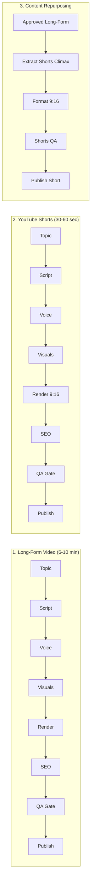

# Creator Studio AI — Milestone 14: Workflow Reference & Standard Templates
## Production Workflow Templates, Stage Specifications & Prerequisites

**Project Owner:** Muhammad Ali  
**Portfolio:** [alibuild.site](https://alibuild.site)  
**System:** Creator Studio AI  
**Milestone:** M14 of 15  
**Document Status:** Production Reference  

---

## 1. Overview of Workflow Templates

Creator Studio AI provides 8 standard, production-ready workflow templates designed for high-retention content creation in the core niche (*AI Tools, Developer Productivity, Practical Web Technology & Coding*).

Each template defines:
- **Stages & Execution Sequence**
- **Inter-Stage Dependencies**
- **Default Resource Usage Profile**
- **Mandatory Approval Checkpoints**
- **Failure Recovery Policy**

---

## 2. Standard Workflow Catalog



### Detailed Template Specifications

### 1. `TEMPLATE_LONG_FORM` — Complete Long-Form Video Production
- **Target Duration:** 6–10 minutes (360–600 seconds, ~900–1,500 words at 140 WPM).
- **Format:** 16:9 Landscape (1920x1080, 30fps).
- **Stages:**
  1. `stage_topic`: Select or validate high-opportunity niche topic.
  2. `stage_script`: Procedural script generation, fact-checking, and scene-by-scene storyboard structuring. *(Checkpoint: Script Approval)*
  3. `stage_narration`: High-fidelity multi-speaker narration synthesis and audio normalization (-14 LUFS).
  4. `stage_visuals`: Visual asset selection (code captures, motion graphics, synthetic animations).
  5. `stage_render`: FFmpeg video assembly with dynamic subtitle overlay.
  6. `stage_metadata`: Thumbnail generation (3 variants) and YouTube SEO title/tags/description.
  7. `stage_qa`: 14-point autonomous QA audit with veto gate. *(Checkpoint: Final QA Approval)*
  8. `stage_publishing`: Resumable YouTube upload with privacy scheduling. *(Checkpoint: Authorization Policy)*

### 2. `TEMPLATE_SHORTS` — YouTube Shorts Production
- **Target Duration:** 30–60 seconds (~80–150 words).
- **Format:** 9:16 Vertical (1080x1920, 30fps).
- **Stages:** Same pipeline as Long-Form, optimized for high initial hook velocity (> 70% retention target at 30s) and rapid scene pacing (2–3s cuts).

### 3. `TEMPLATE_REPURPOSING` — Long-Form to Shorts Climax Extraction
- **Prerequisite:** Approved or Published Long-Form Video.
- **Stages:** Extract high-retention chapter or hook segment $\rightarrow$ Reformulate script $\rightarrow$ Re-render in 9:16 $\rightarrow$ QA Gate $\rightarrow$ Publish Short.

### 4. `TEMPLATE_MINI_SERIES` — Multi-Episode Educational Series
- **Scope:** 3–5 coordinated episodes following a unified curriculum or tool walkthrough.
- **Stages:** Series Curriculum Planning $\rightarrow$ Batch Scripting $\rightarrow$ Coordinated Production $\rightarrow$ Sequential Publication Scheduling.

### 5. `TEMPLATE_TOPIC_RESEARCH_ONLY` — Deep Topic Discovery & Niche Validation
- **Scope:** Ideation, search demand scoring, and semantic deduplication.
- **Stages:** Run `DISCOVER_TOPICS` job $\rightarrow$ Compute opportunity scores $\rightarrow$ Populate review queue.

### 6. `TEMPLATE_SCRIPT_ONLY` — Script Synthesis & Factual Verification
- **Scope:** Convert approved topic into fully fact-checked script with citations without launching media production.

### 7. `TEMPLATE_RECOVERY` — Production Remediation & Re-render
- **Scope:** Targeted re-execution of a failed downstream stage (e.g., re-render after asset replacement or failed YouTube network upload) preserving upstream assets.

### 8. `TEMPLATE_ANALYTICS_PLANNING` — Telemetry-Driven Strategy Planner
- **Scope:** Ingest M13 channel performance $\rightarrow$ Compute 30s hook baselines $\rightarrow$ Generate 5 tailored topic opportunities with retention feedback multipliers.

---

## 3. Template Configuration Schema

All workflow templates conform to a standardized JSON schema:

```json
{
  "template_key": "TEMPLATE_LONG_FORM",
  "name": "Standard Long-Form Production",
  "content_format": "LONG_FORM",
  "estimated_duration_sec": 480,
  "stages": [
    {
      "stage_key": "topic",
      "job_type": "DISCOVER_TOPICS",
      "required": true,
      "approval_required": false
    },
    {
      "stage_key": "script",
      "job_type": "GENERATE_SCRIPT",
      "dependencies": ["topic"],
      "required": true,
      "approval_required": true
    },
    {
      "stage_key": "voice",
      "job_type": "GENERATE_NARRATION",
      "dependencies": ["script"],
      "required": true,
      "approval_required": false
    },
    {
      "stage_key": "visuals",
      "job_type": "PLAN_VISUALS",
      "dependencies": ["script"],
      "required": true,
      "approval_required": false
    },
    {
      "stage_key": "render",
      "job_type": "RENDER_VIDEO",
      "dependencies": ["voice", "visuals"],
      "required": true,
      "approval_required": false
    },
    {
      "stage_key": "seo",
      "job_type": "GENERATE_THUMBNAIL_AND_METADATA",
      "dependencies": ["render"],
      "required": true,
      "approval_required": false
    },
    {
      "stage_key": "qa",
      "job_type": "EVALUATE_PUBLICATION_READINESS",
      "dependencies": ["render", "seo"],
      "required": true,
      "approval_required": true
    },
    {
      "stage_key": "publish",
      "job_type": "YOUTUBE_PUBLICATION_DISPATCH",
      "dependencies": ["qa"],
      "required": true,
      "approval_required": true
    }
  ]
}
```
