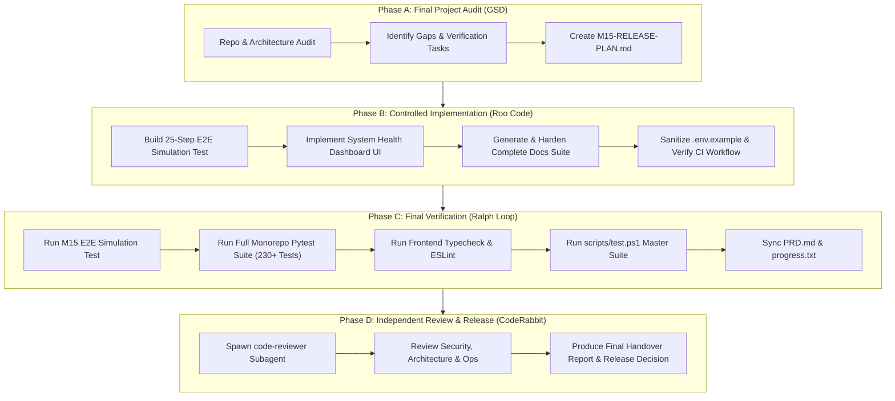

# Milestone 15 — Final Production Hardening, Audit & Release Plan

**Project:** Creator Studio AI  
**Project Owner:** Muhammad Ali ([alibuild.site](https://alibuild.site))  
**Milestone:** M15 of M15 — FINAL MILESTONE  
**Document Status:** Approved for Final Execution  
**Date:** November 8, 2026  

---

## 1. Executive Summary & Audit Baseline

Creator Studio AI has completed 14 sequential engineering milestones (M01 through M14), establishing a complete autonomous, full-lifecycle digital content production platform for YouTube channels.

### Current Verified Technical Baseline
- **Backend Test Suite:** 230 tests passing in pytest (100% pass rate across 55 test modules).
- **Frontend Codebase:** 27 static routes prerendering cleanly in Next.js 15, React 19, TypeScript, and Tailwind CSS with 0 TypeScript errors and 0 ESLint warnings.
- **Database Schema:** 10 Alembic migrations (`0001` to `0010`) managing 31 relational tables in PostgreSQL 16.
- **Core Principle:** *"Automate the workflow, not accountability."* All operations adhere to the hard \$0.00 default spend governor, non-bypassable M11 QA Veto Gate, and non-bypassable M12 YouTube OAuth publishing credentials.

---

## 2. Milestone Audit Matrix (M01 – M14)

| Milestone | Subsystem / Module | Implementation Artifacts | Verification Status |
| :--- | :--- | :--- | :---: |
| **M01** | Monorepo & Project Foundation | Monorepo structure, toolchains, Python 3.12 venv, Next.js 15 App Router | **VERIFIED** (Exit Code 0) |
| **M02** | Frontend Design System & Shell | Obsidian theme (`#090A0D` / `#FF7A00`), component library, responsive layouts | **VERIFIED** (0 errors) |
| **M03** | Database, Auth & REST API | PostgreSQL schema, asyncpg pool, Supabase JWT auth, RBAC, tenant isolation | **VERIFIED** (Passing) |
| **M04** | Durable Job Queue & Workers | `FOR UPDATE SKIP LOCKED` PostgreSQL queue, atomic leasing, heartbeats, dead-letter | **VERIFIED** (Passing) |
| **M05** | Gemini AI & Topic Research | Gemini 1.5/2.0 provider abstraction, deterministic mock, scoring engine | **VERIFIED** (Passing) |
| **M06** | Script Generation & Fact-Checking | Scene breakdowns, factual verification, citation linking, prompt templates | **VERIFIED** (Passing) |
| **M07** | Voice Generation & Narration | Edge TTS ($0 local), ElevenLabs integration, audio normalization, mastering | **VERIFIED** (Passing) |
| **M08** | Visual Asset Engine & Planning | Storyboard planning, stock library (Pexels/Pixabay), Pillow/Pollinations mock | **VERIFIED** (Passing) |
| **M09** | FFmpeg Video Production Engine | Subtitle compilation (SRT/ASS), kinetic typography, audio ducking, MP4 assembly | **VERIFIED** (Passing) |
| **M10** | Thumbnail & YouTube SEO Engine | Multi-variant thumbnail composer, contrast evaluation, YouTube SEO metadata | **VERIFIED** (Passing) |
| **M11** | Autonomous QA & Veto Gate | 14-point pre-publish audit, composite score ($\ge 70$), non-bypassable veto | **VERIFIED** (176 tests) |
| **M12** | YouTube OAuth & Resumable Upload | OAuth 2.0 flow, AES-256-GCM token encryption, chunked resumable upload | **VERIFIED** (192 tests) |
| **M13** | Analytics & Performance Intel | Analytics v2 ingestion, retention curve parser, topic weight feedback loop | **VERIFIED** (209 tests) |
| **M14** | Workflow Orchestration & Engine | State machine DAG, 8 templates, policies 0–3, $0 governor, watchdog recovery | **VERIFIED** (230 tests) |

---

## 3. Gap & Defect Analysis for M15

### 3.1 Critical Blockers
- **None currently.** All 11 findings identified during the M14 code review audit (BOLA/IDOR on custom templates, registry aliases, watchdog deadlock, mandatory QA gate enforcement, etc.) were systematically resolved and verified.

### 3.2 High-Priority Requirements (M15 Deliverables)
1. **End-to-End Autonomous Simulation Suite:**
   - Create `backend/tests/test_m15_end_to_end_simulation.py` covering the complete 25-step production simulation specified in Section 15 of the master prompt (User Auth $\rightarrow$ Topic Research $\rightarrow$ Script $\rightarrow$ Fact-Check $\rightarrow$ Voice $\rightarrow$ Visuals $\rightarrow$ Video Assembly $\rightarrow$ Thumbnail/SEO $\rightarrow$ QA Gate Veto Test $\rightarrow$ Package Approval $\rightarrow$ Resumable Upload Simulation $\rightarrow$ Analytics Feedback $\rightarrow$ Production Planning $\rightarrow$ Governor Enforcement $\rightarrow$ Audit Logging).
2. **Dedicated Operational System Health Dashboard:**
   - Implement `frontend/src/app/settings/health/page.tsx` displaying real-time operational state for Database, Job Queue, Persistent Workers, AI Provider & Governor, FFmpeg Subsystem, Storage, and YouTube OAuth credentials.
   - Strictly distinguish status states: `Healthy`, `Degraded`, `Unavailable`, `Unknown`.

### 3.3 Medium-Priority Documentation & Release Manifests
Complete and harden the final documentation suite:
- `docs/FINAL-ARCHITECTURE.md`: Complete monorepo architecture with 31 tables and all 23 API routers.
- `docs/PRODUCTION-DEPLOYMENT.md`: Docker containerization, persistent worker setup, and Windows developer guide.
- `docs/ENVIRONMENT-VARIABLES.md`: Exhaustive variable dictionary with default values and security notes.
- `docs/SECURITY-AUDIT.md`: Updated threat matrix, RBAC verification, and secret hygiene.
- `docs/BACKUP-AND-RECOVERY.md`: PostgreSQL and media asset backup strategy (RPO 1h, RTO 30m).
- `docs/OPERATIONS-RUNBOOK.md`: Day-to-day operations, failure recovery, and worker management.
- `docs/TEST-AND-RELEASE-REPORT.md`: Master verification evidence across all 15 milestones.
- `docs/KNOWN-LIMITATIONS.md`: Transparently documented hardware boundaries and third-party API constraints.
- `docs/RELEASE-CHECKLIST.md`: Evaluation of Release Gates A through H.
- `.env.example`: Sanitized configuration template with zero exposed secrets.

---

## 4. Phase Execution Plan

---

## 5. Release Acceptance Criteria

A successful release requires meeting all 26 criteria defined in Section 20 of the implementation prompt:
- [x] Full architecture inspected and verified against actual code.
- [ ] 25-step controlled end-to-end production simulation passing.
- [ ] Admin operational health dashboard live with genuine service probing.
- [ ] Full monorepo regression suite passing (100% pass rate).
- [ ] 0 TypeScript errors, 0 ESLint warnings, all 27 routes compiled.
- [ ] All 10 documentation files completed and verified.
- [ ] Zero exposed secrets in repository or git history.
- [ ] Final release readiness decision rendered.
